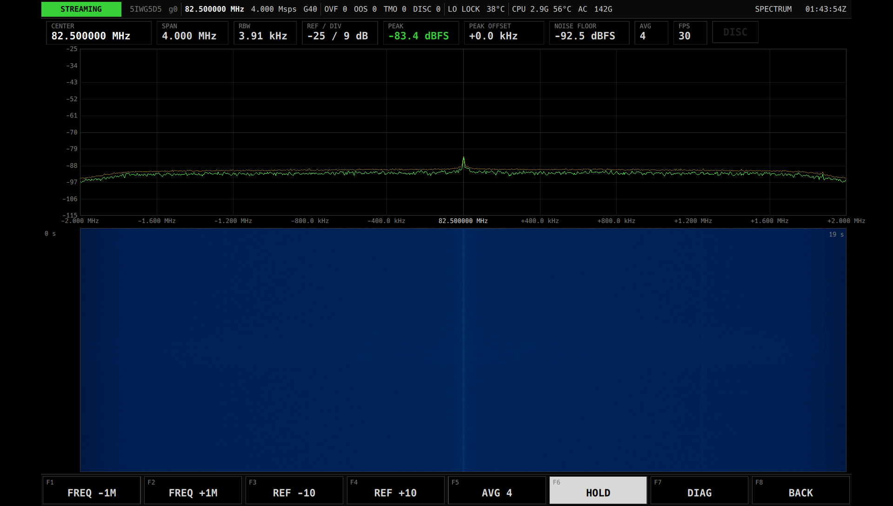
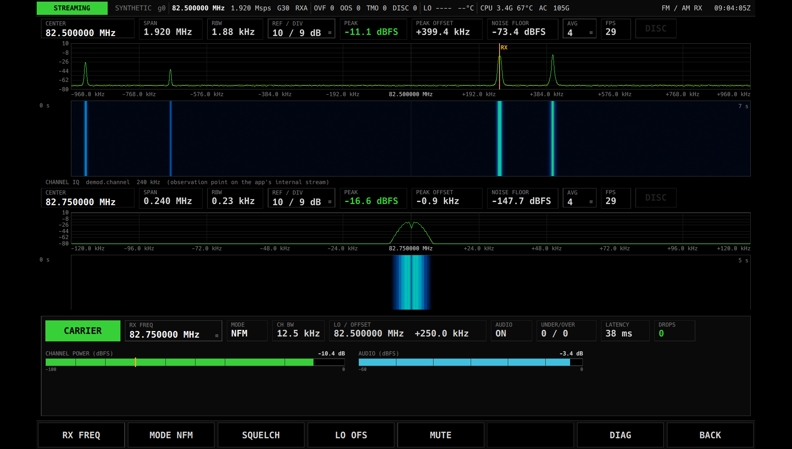
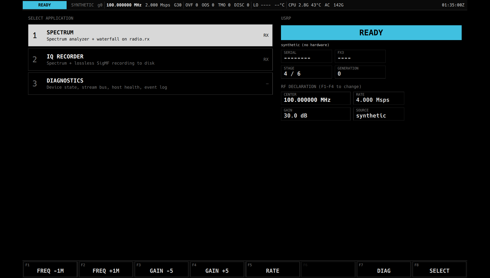
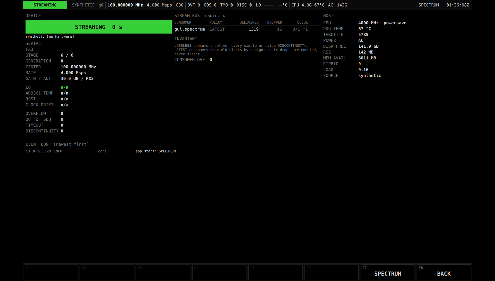

# S.P.E.A.R.

Signal Processing & Emission Analysis Receiver

タブレット PC と USRP B210 を、持ち運べるタッチ操作の電波受信機・解析器にするソフトウェアです。
スペクトラム観測から、デジタル簡易無線や ADS-B の受信・解読まで、メニューから選ぶだけで使えます。



## 主な機能

- **SPECTRUM** — スペクトラムとウォーターフォール。画面をタッチして選局。
- **IQ RECORDER** — IQ データを SigMF 形式で欠落なく録音。録音は後から再生・解析できます。
- **FM / AM RX** — NFM / WFM / AM の復調と音声再生。
- **STD-T98 MONITOR** — デジタル簡易無線 30 チャネルを同時に受信・復号・音声再生。秘話の解除にも対応。
- **ADS-B** — 1090 MHz で航空機の位置を受信し、一覧と地図で表示。地図は内蔵でオフライン動作。
- **JR TRAIN RADIO** — JR 在来線デジタル列車無線(352.6 MHz 帯)の全チャネルを同時に受信・復号。音声の再生(通話の自動選択)、データ電文と運行把握の表示、復号結果と IQ の保存。**開発中: 実機(B210)での動作確認はこれから**([`docs/apps/jr_train.md`](docs/apps/jr_train.md))。

そのほか:

- タッチ操作だけで完結。キーボードもマウスも不要です。
- 受信状態とエラーを常に画面に表示。USB が抜けても、挿し直せば自動で復帰します。
- B210 が無くても、録音ファイルや合成信号で動かせます。

<table><tr>
<td></td>
<td></td>
</tr><tr>
<td></td>
<td></td>
</tr></table>

## 必要な機材

| 機材 | 内容 |
|---|---|
| PC | Panasonic FZ-G2(1920×1200、タブレットモードで使用) |
| SDR | Ettus Research USRP B210(互換機を含む)。USB 2.0 で接続します |
| アンテナ | 受信したい周波数帯に合ったもの |
| OS | Arch Linux(KDE Plasma で動作を確認) |

上記以外の PC や SDR には対応していません。

## 導入方法

1. 依存パッケージをインストールします。

   ```
   sudo pacman -S --needed base-devel git cmake ninja qt6-base qt6-declarative fftw gtest boost alsa-lib onnxruntime-cpu
   ```

2. パッチを当てた libuhd をビルドしてインストールします。公式の libuhd のままでは、USB を抜き差ししたときに異常終了します。

   ```
   cd packaging/libuhd
   makepkg -s
   sudo pacman -U libuhd-*.pkg.tar.zst libuhd-utils-*.pkg.tar.zst
   ```

   公式パッケージの更新で上書きされないよう、`/etc/pacman.conf` に `IgnorePkg = libuhd libuhd-utils` を追加してください。詳しくは [`packaging/libuhd/README.md`](packaging/libuhd/README.md) を参照してください。

3. B210 用の FPGA / ファームウェアイメージを取得します。

   ```
   sudo uhd_images_downloader -t b2xx
   ```

4. S.P.E.A.R. をビルドします。

   ```
   cmake -S . -B build -G Ninja && ninja -C build
   ```

5. B210 を接続して起動します。初回は FPGA の書き込みに 1 分ほどかかります。

   ```
   ./spear.sh                      # 全画面で起動
   ./spear.sh --windowed           # ウィンドウで起動
   ./spear.sh --source synthetic   # B210 なしで試す(合成信号)
   ```

   `scripts/install-desktop.sh` を実行すると、KDE Plasma のメニューとデスクトップに起動アイコンが登録されます。

録音・ログは `~/spear/` に保存されます。B210 個体の周波数誤差などの設定は `~/spear/site.conf` に書きます([`docs/tools.md`](docs/tools.md))。
開発者向けの情報は [`docs/DEVELOPMENT.md`](docs/DEVELOPMENT.md) にあります。

## ライセンス

GPL-3.0-or-later。一部のコードとデータのライセンスについては [`LICENSE`](LICENSE) と各ファイルの表記を参照してください。

## 謝辞

JR 在来線デジタル列車無線の受信機能は、KIRISHIKI Yudai 氏による [jr-conventional-line-radio-receiver](https://github.com/soltia48/jr-conventional-line-radio-receiver) の解析と実装を全面的に活用させていただいています。
膨大な労力を要したであろう成果を OSS として公開してくださったことに深く感謝します。
