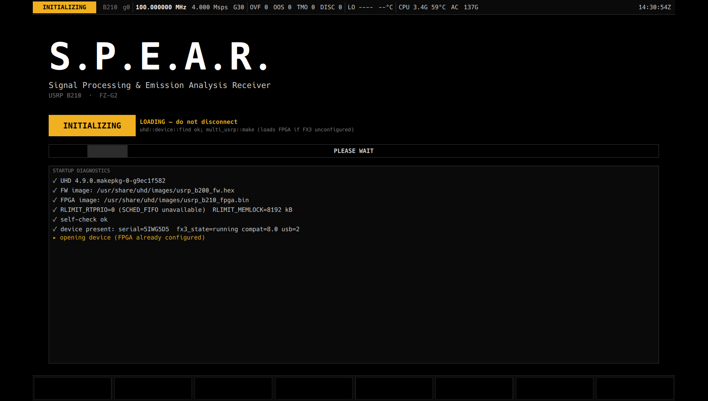
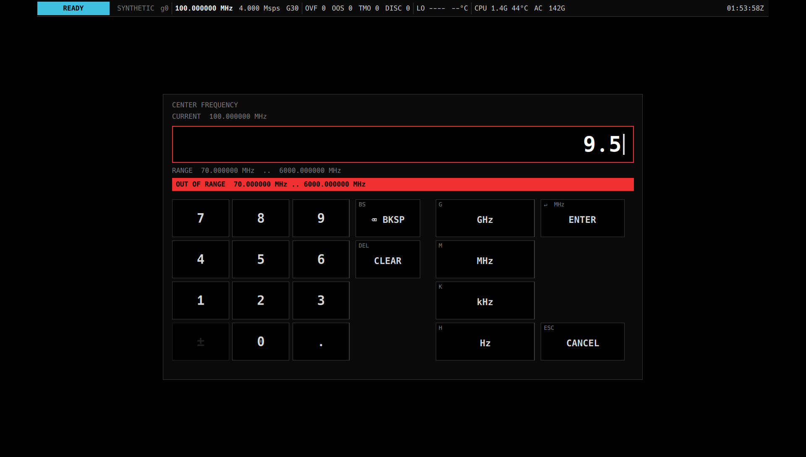
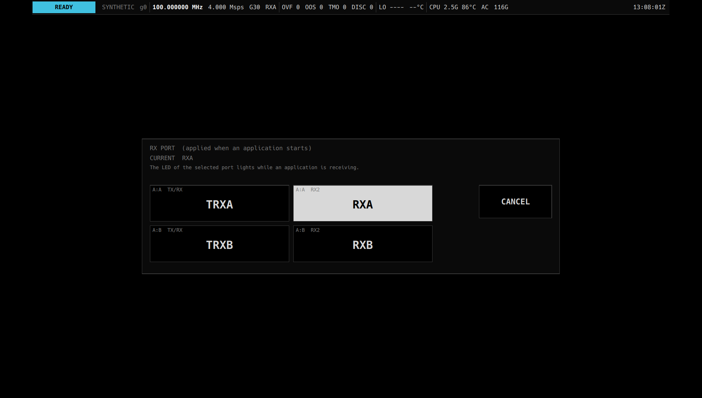

# S.P.E.A.R. 説明書

S.P.E.A.R. は、タブレット PC(Panasonic FZ-G2)と USRP B210 を、持ち運べる電波受信機・解析器として使うためのソフトウェアです。
操作はすべて画面のタッチで行います。キーボードとマウスは使いません。

この文書では、すべてのアプリケーション(以下 App)に共通する操作を説明します。App ごとの使いかたは、それぞれの説明書を見てください。

## App の説明書

| App | 内容 | 説明書 |
|---|---|---|
| SPECTRUM | スペクトラムとウォーターフォールで電波を見る | [spectrum.md](spectrum.md) |
| IQ RECORDER | 受信した信号を欠落なく録音する | [recorder.md](recorder.md) |
| FM / AM RX | FM / AM の放送や無線を聞く | [demod.md](demod.md) |
| STD-T98 MONITOR | デジタル簡易無線 30 チャネルを同時に受信して聞く | [std_t98.md](std_t98.md) |
| ADS-B | 航空機の位置を受信して一覧と地図に出す | [adsb.md](adsb.md) |
| SLPR 20CH RX | 特定小電力トランシーバー 20 チャネルを同時に受信して聞く | [slpr.md](slpr.md) |
| JR TRAIN RADIO | JR 在来線デジタル列車無線を全チャネル同時に受信して、音声とデータを見る(開発中) | [jr_train.md](jr_train.md) |

## 用意するもの

| 機材 | 内容 |
|---|---|
| PC | Panasonic FZ-G2。タブレットモードで使います |
| SDR | USRP B210(互換機を含む)。USB 2.0 で接続します |
| アンテナ | 受信したい周波数帯に合ったもの。B210 の受信端子(`RX PORT` で選んだもの)につなぎます |

ソフトウェアの導入方法はリポジトリの [`README.md`](../../README.md) にあります。

## 起動する

デスクトップかスタートメニューの S.P.E.A.R. のアイコンをタップします。端末から起動する場合は `./spear.sh` を実行します。

起動すると、まずスプラッシュ画面が出ます。ここでは B210 の立ち上げの経過(自己診断、装置の検出、FPGA の書き込み、周波数設定の確認)が表示されます。

- B210 の電源を入れてから最初の起動では、FPGA の書き込みに 1 分ほどかかります。`LOADING — do not disconnect` と出ている間は、USB ケーブルを抜かないでください。
- 立ち上げが終わると `WELCOME` と表示されて起動音が鳴り、メニューに移ります。
- B210 が見つからないまま待っているときは、右下に `CONTINUE` が出ます。押すと待つのをやめてメニューに進みます。



## メニュー


左側が App の一覧です。使いたい App をタップすると、その App が始まります。
App が受信の準備をしている間は `APPLYING RF CONFIGURATION ...` と表示されます。App を始められなかったときは、赤字で `APP START REJECTED:` に続けて理由が出ます。

右側は B210 の状態と、すべての App に共通する受信の設定です。

| 表示 | 意味 |
|---|---|
| `USRP` の色の帯 | 装置の状態(下の「装置の状態」を参照)。その下の小さな文字は、状態を判断した根拠です |
| `SERIAL` | 接続している B210 のシリアル番号 |
| `FX3` / `STAGE` / `GENERATION` | 立ち上げの段階と、接続し直した回数。ふだんは気にしなくてかまいません |
| `GAIN` | 受信の利得。タップすると数値入力が開きます(下の「受信の利得」を参照) |
| `RX PORT` | アンテナをつなぐ受信端子。タップすると選択画面が開きます(下の「受信端子」を参照) |
| `SOURCE` | 信号の入力元(実機の B210、録音ファイル、合成信号) |
| `LAST CENTER` / `LAST RATE` | 最後に使った受信周波数とサンプルレート |

受信周波数とサンプルレートは App ごとに決まっているので、メニューにはありません。周波数を自由に変えられるのは SPECTRUM、IQ RECORDER、FM / AM RX です。

### 受信の利得(`GAIN`)

`GAIN` をタップすると数値入力が開きます。0〜76 dB を入れるか、`AGC` を押して自動利得にします。

- AGC にすると、`GAIN` の欄に白い × と `AGC` の文字が重なります。数値は AGC を切ったときに戻る値です。
- 利得は App を始めるときに設定されます。App を使っている途中で変えるときは、`BACK` でメニューに戻ってから変えてください。

強い電波の近くで利得を上げすぎると、信号がひずんで受信できなくなることがあります。そのときは利得を下げてください。

### 受信端子(`RX PORT`)

`RX PORT` をタップすると、B210 の 4 つの受信端子 `TRXA` / `RXA` / `TRXB` / `RXB` から選べます。押した端子にすぐ決まります。
選んだ端子は App を始めるときに設定され、受信している間はその端子の LED が点きます。アンテナをつないだ端子を選んでください。

## 画面の構成

App を使っている間は、画面が上から次の 3 つに分かれます。

1. ステータスバー(いちばん上の 1 行)。どの App でも常に表示されます。
2. App の画面
3. ソフトキー(いちばん下の 8 個のキー)

### ステータスバー

左から順に次の項目が並びます。赤い文字は、確認が必要な状態です。

| 表示 | 意味 |
|---|---|
| 色の帯(`STREAMING` など) | 装置の状態(下の「装置の状態」を参照) |
| シリアル番号 / `g` と数字 | 使っている B210 と、接続し直した回数 |
| 周波数 / サンプルレート | いま受信している中心周波数と、サンプルレート |
| `G30` / `AGC` | 受信の利得(手動の dB 値、または AGC) |
| `TRXA` など | いま受信している端子 |
| `OVF` / `OOS` / `TMO` / `DISC` | 受信データの欠落の回数。0 以外は赤になります(下の「受信データの欠落」を参照) |
| `LO LOCK` / `LO UNLOCK` と温度 | 受信機の局部発振器の状態と、B210 の受信チップの温度 |
| `CPU` | PC の CPU の周波数と温度。90 °C 以上で赤になります |
| `AC` / `BAT` | 電源。バッテリーで動いているときは赤になります |
| `123G` など | 録音先のディスクの空き容量。2 GB を切ると赤になります |
| 右端 | 動いている App の名前と時刻 |

### 装置の状態

| 表示 | 色 | 意味 |
|---|---|---|
| `STREAMING` | 緑 | 受信しています |
| `READY` | 水色 | 準備ができていて、受信はしていません(メニューにいるとき) |
| `STANDBY` / `INITIALIZING` / `NO_FIRMWARE` | 琥珀 | 立ち上げ中です。FPGA の書き込み中は USB を抜かないでください |
| `DISCONNECTED` | 灰 | B210 が見つかりません |
| `FAULT` / `LOST` | 赤 | 異常が起きたか、受信中に B210 が見えなくなりました |

受信中に USB ケーブルが抜けても、挿し直せば自動で立ち上げ直し、受信に戻ります。

### 受信データの欠落

| 表示 | 意味 |
|---|---|
| `OVF` | PC の処理が追いつかず、B210 側でデータがあふれた回数 |
| `OOS` | データの順番が乱れた回数 |
| `TMO` | データが届かなかった回数 |
| `DISC` | 受信データに切れ目ができた回数(録音や復号の処理が追いつかなかった場合など) |

ときどき増えるのが続くときは、ほかの重いプログラムを止める、AC 電源につなぐ、などを試してください。
詳しい状況は診断画面(`DIAG`)で確認できます。

### ソフトキー

画面下の 8 個のキーは、そのとき開いている画面によって変わります。グレーのキーは、いまは押せません。白く反転しているキーは、その機能がオンになっていることを示します。

- いちばん右のキーは、App や診断画面では `BACK` です。押すと App を止めてメニューに戻ります。
- メニューでは、いちばん左が `EXIT` です。押すと確認画面が出て、`EXIT` を押すと S.P.E.A.R. を終了します(B210 も解放されます)。`CANCEL` で取り消します。

## 数値の入力



周波数や利得などの数値は、画面に出るテンキーで入力します。計測器と同じく、数字を打ってから単位のキーで確定します。

1. 数字キーと `.` で値を打ちます。`±` は負の値を入れられる項目でだけ押せます。
2. 単位のキー(`MHz`、`kHz` など)を押すと、その単位で確定します。`ENTER`(緑)を押すと、`ENTER` の下に書いてある単位で確定します。
3. 打ち間違えたときは `⌫ BKSP` で 1 文字消し、`CLEAR` で全部消します。`CANCEL` で何も変えずに閉じます。

例: 145.5 MHz に合わせるときは `1` `4` `5` `.` `5` `MHz` と押します。

範囲外の値を入れると、入力画面を閉じずに赤い帯で理由が表示され、拒否の音が鳴ります。入力をやり直してください。

## 選択の入力



受信端子のように選択肢が少ない項目は、大きなキーを並べた選択画面で選びます。いまの値は反転して表示されます。押したキーにすぐ決まります。

## 操作の音

キーを押して入力が受け付けられると、短いタップ音が鳴ります。数値入力で値が拒否されたときは、別の音が鳴ります。
音量は OS の設定で調整します。App の `MUTE` は受信音声だけを消し、操作の音は消しません。

## 診断画面(`DIAG`)


App のソフトキーの `DIAG` を押すと、診断画面が開きます。`DIAG` キーのない SPECTRUM では、メニューの一覧のいちばん下にある `DIAGNOSTICS` から開きます。受信がうまくいかないときに、原因を探すために使います。`BACK` で元の画面に戻ります。

| 区画 | 内容 |
|---|---|
| `DEVICE` | 装置の状態と根拠、受信周波数、利得、端子、周波数の補正値(`LO CORR`)、受信チップの温度、欠落の回数 |
| `STREAM BUS  radio.rx` | 受信データを使っている処理の一覧と、それぞれが受け取った数・取りこぼした数。`LOSSLESS` の処理(録音や復号)で `DROPPED` が赤くなったら、その分のデータが欠けています |
| `HOST` | PC の CPU、温度、電源、ディスクの空き、メモリ |
| `EVENT LOG` | 起きた出来事の履歴(新しいものが上)。琥珀や赤の行が問題の手がかりです |

## 設定の保存

App の設定(利得、AGC、受信端子、各 App のモードや表示範囲など)は自動で保存され、次に起動したときに元に戻ります。保存のための操作はありません。

| ファイル | 内容 |
|---|---|
| `~/spear/state.conf` | 自動で保存される運転状態。削除すると、次の起動から初期の状態に戻ります |
| `~/spear/site.conf` | B210 の個体差などの、手で書く設定(`key=value` の行)。`state.conf` より優先されます |
| `~/spear/recordings/` | 録音したファイル |
| `~/spear/logs/` | 起動ごとのログとイベントの履歴 |

B210 には個体ごとに少し周波数のずれがあります。デジタル無線の App で受信がずれるときは、`site.conf` に `radio.freq_err_ppm=<ずれ ppm>` を書いて補正します。

## B210 なしで試す

B210 がなくても、録音ファイルや合成信号で画面と操作を試せます。

```
./spear.sh --source file:<録音ファイル名(拡張子なし)>   # 録音を再生する
./spear.sh --source synthetic                          # 合成信号
./spear.sh --windowed                                   # 全画面ではなくウィンドウで開く
```

## 注意

- S.P.E.A.R. は受信専用です。電波を送信する機能はありません。
- 自分あての通信でない無線の内容を、他人に漏らしたり、自分や他人のために利用したりすることは、電波法(第 59 条)で禁じられています。受信した内容の扱いに注意してください。
