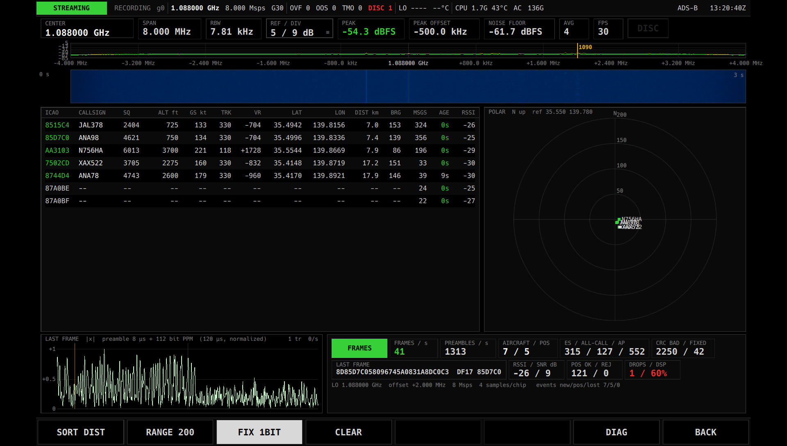

# ADS-B 説明書

ADS-B は、航空機が 1090 MHz で送っている電波(Mode S / ADS-B)を受信して、近くを飛んでいる航空機の便名・高度・速度・位置を一覧表と地図に表示する App です。
地図は App に組み込まれているので、インターネットにつながっていなくても使えます。

メニュー、ステータスバー、`GAIN` / `RX PORT`、`DIAG`、`BACK`、`EXIT`、数値の入力などの共通の操作は [共通の操作](README.md) を見てください。



## できること

- 受信した航空機を一覧表に表示します(機体の識別番号、便名、スコーク、高度、対地速度、針路、昇降率、緯度・経度、受信数、最後に受信してからの時間、受信の強さ)。
- 位置がわかった航空機を地図に表示します。向きのわかる機体は進行方向を向いた三角で表示し、通ってきた跡(航跡)も描きます。
- 地図は、位置のわかった全機が画面に収まるように自動で範囲を合わせます。指で動かしたり、拡大・縮小したりもできます。
- 地図には海岸線、湖、国境・県境、都市名、空港、滑走路(実際の長さと向き)、緯線・経線、縮尺が出ます。
- 表か地図で機体をタップすると、その機体を選んで目立たせることができます。
- 最後に受け取った電文の波形と、受信の状況(電文の数、機数、誤りの数など)を表示します。

## 用意するもの

| 機材 | 内容 |
|---|---|
| アンテナ | 1090 MHz 用のアンテナ。B210 の受信端子(`RX PORT` で選んだもの)につなぎます |
| 置き場所 | 空が広く見える場所。窓際や屋外のほうがよく受信できます。空港の近くでは低い高度の機体も受信できます |

受信周波数とサンプルレートは App が決めます(1090 MHz の少し下に合わせ、8 Msps で受信します)。周波数を設定する必要はありません。

### 受信地点の登録(任意)

受信する場所の緯度・経度を `~/spear/site.conf` に書いておくことができます。書かなくても使えます。

```
adsb.ref_lat=35.55
adsb.ref_lon=139.78
```

- 緯度・経度は 10 進数の度で書きます(北緯・東経が正)。2 つとも書いたときだけ有効になります。
- 登録すると、受信地点から 300 km 以内の航空機は、位置が早く(1 回の位置の電文から)求まるようになります。この位置は仮のもので、2 種類の位置の電文がそろった時点で確かめ直します。
- 受信地点から 600 km より遠い位置(誤りと考えられるもの)は捨てるようになります。
- 位置が初めて求まったときの診断画面の記録(`EVENT LOG`)に、受信地点からの距離が付きます。
- 一覧表や地図の表示は、受信地点を登録してもしなくても変わりません。地図の範囲は航空機の位置だけから決まります。
- `site.conf` は起動のときに読み込まれます。書き換えたら S.P.E.A.R. を起動し直してください。

S.P.E.A.R. は持ち運んで使う装置なので、場所を変えたときは書き直すか、行を消してください。実際の場所から遠く離れた地点のままだと、位置が出なかったり、まちがった位置が出たりします。

### 地図について

地図のデータ(Natural Earth の地形・境界・都市と、OurAirports の空港・滑走路)は App に組み込まれていて、全世界を収めています。
ダウンロードや設定は要りません。地図の右上に `Natural Earth · OurAirports` と出ていれば、地図のデータは読み込まれています。

## 起動と終了

1. B210 に 1090 MHz 用のアンテナをつなぎます。
2. メニューの App の一覧で `ADS-B` をタップします。
3. 受信の準備が終わると画面が表示され、受信が始まります。
4. 終わるときは右端のソフトキー `BACK` を押します。受信が止まり、メニューに戻ります。

一覧表の内容は App を終了すると消えます。次に始めたときは空の表から始まります。

利得はメニューかステータスバーの `GAIN` で設定します。ADS-B の電波は短いパルスなので、AGC(自動利得)ではなく固定の利得をおすすめします。

## 画面の見かた

画面は上から、スペクトラム、一覧表と地図、波形と受信の状況、の 3 段です。

### スペクトラム(上段)

受信している 8 MHz 幅の電波の強さです。アンテナや利得が適切かを確かめるために使います。

| 表示 | 意味 |
|---|---|
| `CENTER` | 受信周波数(1090 MHz より 2 MHz 低い 1.088 GHz)。この App では変更できません |
| `SPAN` / `RBW` | 表示している周波数の幅と、細かさ |
| `REF / DIV` | 表示の上端の強さと、1 目盛りあたりの dB。タップすると上端の値を入力できます |
| `PEAK` / `PEAK OFFSET` | いちばん強い信号の強さと、その位置(中心からのずれ) |
| `NOISE FLOOR` | 雑音の強さ |
| `AVG` / `FPS` | 平均の回数と、1 秒あたりの描画回数。`AVG` は枠で囲まれていて、タップするたびに平均回数が 1 → 2 → 4 → 8 → 16 → 1 と変わります |
| `DISC` | 受信データに途切れがあったときに赤く光ります |
| `1090` の線 | 琥珀色の縦線が 1090 MHz の位置です。航空機が多いと、この付近がときどき盛り上がります |

ADS-B の電文はとても短いので、スペクトラムではほとんど見えないことがあります。受信できているかどうかは下段の表示で判断してください。

### 一覧表(中段の左)

受信した航空機を 1 機 1 行で表示します。値がまだわからない欄は `--` になります。

| 列 | 意味 |
|---|---|
| `ICAO` | 機体ごとに決まっている識別番号(16 進数 6 桁)。位置がわかった機体は緑色になります |
| `CALLSIGN` | 便名や機体の登録記号(例: `JAL378`) |
| `SQ` | スコーク(管制から割り当てられた 4 桁の番号) |
| `ALT ft` | 気圧高度(フィート)。地上にいる機体は `GND` |
| `GS kt` | 対地速度(ノット) |
| `TRK` | 針路(度、北が 0)。末尾に `h` が付いているときは、機首の向きです |
| `VR` | 昇降率(フィート/分)。上昇は `+`、降下は `-` |
| `LAT` / `LON` | 緯度・経度(度) |
| `MSGS` | その機体から受け取った電文の数 |
| `AGE` | 最後に受信してからの秒数。5 秒未満は緑、30 秒未満は白、それより古いと灰色になります |
| `RSSI` | 受信の強さ(dB)。0 に近いほど強く、数字が小さい(マイナスが大きい)ほど弱い信号です |

- 最後に受信してから 60 秒たった機体は、表から消えます。
- 1 機も受信していないときは `NO AIRCRAFT` と表示されます。
- 行をタップすると、その機体を選びます。選んだ行は琥珀色の枠で囲まれ、地図でも琥珀色になります。同じ行をもう一度タップすると選択を解除します。
- 表は上下にスクロールできます。並べかたはソフトキーの `SORT` で変えます。

### 地図(中段の右)

位置のわかった航空機を表示します。北が上です。

| 表示 | 意味 |
|---|---|
| 緑の三角 | 航空機。三角の先が進行方向です。向きがまだわからない機体は四角で表示します |
| 機体の横の文字 | 上が便名(わからないときは識別番号)、下が高度(`ft`)。地上の機体は `GND` |
| 細い線 | 航跡(その機体がこれまで通ってきた道筋) |
| 灰色の機体 | 30 秒以上受信していない機体 |
| 琥珀色の機体と丸 | 選んでいる機体 |
| 水色の線 | 滑走路(表示の幅が 250 km 未満のとき) |
| 水色の丸と十字 | 空港。表示の幅が 600 km 未満のときは空港の記号(例: `RJTT`)も出ます |
| 灰色の点と文字 | 都市。表示の幅が広いほど、大きな都市だけになります |
| 点線と端の数字 | 緯線・経線と、その緯度・経度 |
| 左下の目盛り | 縮尺(例: `2 km`) |

左上の行は地図の状態です。

- `MAP  N up` に続けて、`AUTO FIT`(自動で範囲を合わせている)か `MANUAL`(手で動かした)、表示の幅(km)、地図の中心の緯度・経度が出ます。`MANUAL` のときは行全体が琥珀色になります。
- まだ位置のわかった機体がないときは `(no position yet)` と出ます。このときは東京付近を表示しています。
- 右上の `Natural Earth · OurAirports` は地図データの出典です。ここが赤い `MAP DATA MISSING` のときは地図のデータがありません(航空機は表示されます)。

地図の操作:

| 操作 | 動作 |
|---|---|
| 1 本指でドラッグ | 地図を動かします。自動で範囲を合わせるのをやめ、`MANUAL` になります |
| 2 本指で広げる・縮める | 拡大・縮小します。これも `MANUAL` になります |
| 機体をタップ | その機体を選びます。選んでいる機体をもう一度タップすると解除します。機体のない所をタップしても選択は変わりません |

自動で範囲を合わせているときは、機体が画面の外に出そうになるとすぐに広げ、機体が消えたときはゆっくり狭めます。

### 波形(下段の左)

`LAST FRAME` は、最後に正しく受け取った電文の波形です。左側の、間をあけて並んだ 4 本のパルスが電文の始まりの合図(8 µs)で、その後ろにデータが続きます。
見出しに、データの長さ(`56 bit` または `112 bit`)が出ます。琥珀色の縦線はデータの始まる位置です。

### 受信の状況(下段の右)

| 表示 | 意味 |
|---|---|
| 色の四角 | 受信の状態。緑の `FRAMES` は電文を受け取れている、水色の `NOISE` は電文らしいものは来ているが正しく読めていない、灰色の `IDLE` は何も来ていない |
| `FRAMES / s` | 1 秒あたりに正しく受け取った電文の数(直近 5 秒の平均) |
| `PREAMBLES / s` | 1 秒あたりに見つけた、電文の始まりの合図らしいものの数。雑音も含みます |
| `AIRCRAFT / POS` | 表にいる機数 / そのうち位置のわかった機数 |
| `ES / ALL-CALL / AP` | 受け取った電文の種類ごとの数。`ES` は位置や便名などを含む ADS-B の電文、`ALL-CALL` は機体の識別番号だけの短い電文、`AP` は高度やスコークを含む管制向けの返信です |
| `CRC BAD / FIXED` | 誤りがあって捨てた電文の数 / 1 ビットの誤りを直して使った電文の数 |
| `LAST FRAME` | 最後に受け取った電文の中身(16 進数)、種類(`DF` の番号)、識別番号。誤りを直したものには `FIX` が付きます |
| `RSSI / SNR dB` | 最後の電文の受信の強さと、雑音との比 |
| `POS OK / REJ` | 求めた位置の数 / 誤りと判断して捨てた位置の数。捨てたものがあると琥珀色になります |
| `DROPS / DSP` | 受信データの取りこぼしの数 / 処理の負荷。取りこぼしがあると赤、負荷が 80 % を超えると琥珀色になります |
| 最下行 | 受信周波数(`LO`)、1090 MHz からのずれ(`offset`)、サンプルレート、診断画面に記録した出来事の数(`events new/pos/lost` = 新しい機体 / 位置が初めて求まった / 表から消えた) |

## 操作

| キー | 動作 |
|---|---|
| `SORT SEEN` など | 一覧表の並べかたを切り替えます。押すたびに `SEEN` → `CALL` → `ALT` → `MSGS` の順に変わります |
| `MAP FIT` | 地図の範囲を自動で合わせるかどうかを切り替えます。明るく光っているときが自動です。手で動かした後に押すと、すぐに全機が収まる範囲に戻ります |
| `ZOOM −` | 地図を縮小します(広い範囲を表示)。自動で合わせるのをやめます |
| `ZOOM +` | 地図を拡大します(狭い範囲を表示)。自動で合わせるのをやめます |
| `FIX 1BIT` | 1 ビットの誤りがある電文を直して使うかどうかを切り替えます。明るく光っているときが有効です(はじめから有効) |
| `CLEAR` | 一覧表と地図の航空機・航跡をすべて消します。受信は続くので、受信した機体からまた表に出てきます |
| `DIAG` | 診断画面を開きます |
| `BACK` | App を終了してメニューに戻ります |

`SORT` の並べかた:

| 表示 | 並び |
|---|---|
| `SEEN` | 最後に受信した時刻の新しい順(はじめの状態) |
| `CALL` | 便名の順。便名のわからない機体は後ろ |
| `ALT` | 高度の高い順 |
| `MSGS` | 受け取った電文の多い順 |

地図の拡大・縮小は、表示の幅で 5 km から 5000 km までです。

`FIX 1BIT` を有効にすると、受け取れる電文が少し増えます。誤りを直した電文は、すでに表にいる機体のものだけを使うので、存在しない機体が表に出ることはありません。

## 使いかたの例

### 近くを飛んでいる航空機を見る

1. 1090 MHz 用のアンテナをつなぎ、窓際など空の見える場所に置きます。
2. メニューで `ADS-B` を始めます。
3. 下段の四角が緑の `FRAMES` になり、表に機体が出てくるのを待ちます。位置の電文は 1 秒に数回しか来ないので、地図に出るまで数秒かかります。
4. 地図は自動で全機が収まる範囲になります。

### 特定の機体を追いかける

1. 表の行か、地図の機体をタップして選びます。琥珀色になります。
2. 地図を指で動かしたり、`ZOOM +` で拡大したりして、その機体の周りを見ます。
3. 全体に戻すときは `MAP FIT` を押します。
4. 選択を解除するときは、同じ行か機体をもう一度タップします。

### 空港への着陸を見る

1. 空港の近くで受信し、`ZOOM +` かピンチで表示の幅を 250 km 未満にします。滑走路が水色の線で出ます。
2. `SORT ALT` にすると、高度の低い機体(着陸の直前や離陸の直後)が表の下のほうに集まります。
3. `VR` がマイナスなら降下中、プラスなら上昇中です。

### 受信の調子を確かめる

1. 下段の `FRAMES / s` と `AIRCRAFT / POS` を見ます。
2. `NOISE` のままで電文が読めないときは、`GAIN` を変えたりアンテナの置き場所を変えたりして、`FRAMES / s` が増えるところを探します。
3. `DROPS / DSP` が赤くなるときは、PC の処理が追いついていません(「困ったとき」を参照)。

## 保存される設定

次の設定は自動で保存され、次に始めたときに元に戻ります。

| 設定 | 内容 |
|---|---|
| 表の並べかた | `SORT` で選んだもの |
| `FIX 1BIT` | 有効か無効か |
| スペクトラムの表示範囲 | `REF / DIV` で設定した値と平均の回数 |

次のものは保存されません。

- 一覧表の機体、航跡、選んでいる機体
- 地図の範囲(始めたときは自動で合わせる状態に戻ります)

受信地点(`adsb.ref_lat` / `adsb.ref_lon`)は `~/spear/site.conf` に手で書く設定です(「受信地点の登録」を参照)。

## 録音の解析

IQ RECORDER で、受信周波数 1.088 GHz(1090 MHz − 2 MHz)、サンプルレート 8 Msps で録音したファイルは、あとから PC で解析できます。

```
./build/tools/spear-adsb-decode ~/spear/recordings/<録音ファイル名(拡張子なし)> [--ref <緯度>,<経度>]
```

受け取った電文の一覧、統計、航空機の一覧を出力します。`--ref` は「受信地点の登録」と同じ意味です。詳しい使いかたはリポジトリの [`docs/tools.md`](../tools.md) にあります。

録音を App で再生して画面を確かめることもできます([共通の操作](README.md) の「B210 なしで試す」を参照)。

## 困ったとき

| 症状 | 原因 | 対処 |
|---|---|---|
| `IDLE` のまま、表に何も出ない | アンテナがつながっていない、または `RX PORT` が違う | アンテナの接続と `RX PORT` を確かめてください |
| `IDLE` のまま、表に何も出ない | 近くを飛んでいる機体がない、建物の中で電波が届かない | 窓際や屋外に移ってください |
| `NOISE` のまま、`FRAMES / s` が 0 | 利得が低すぎる、または高すぎて信号がひずんでいる | `GAIN` を変えて `FRAMES / s` が増えるところを探してください。AGC ではなく固定の利得にしてください |
| 表に機体は出るが地図に出ない | 位置を送っていない機体か、位置の電文をまだ十分受け取れていない | しばらく待ってください。識別番号だけ・高度だけの機体もあります |
| 地図に機体が出るまで時間がかかる | 位置を求めるには 2 種類の位置の電文がそろう必要がある | `site.conf` に受信地点を登録すると早く出るようになります |
| 場所を移ったら、位置が出ない、または出始めに位置がおかしい | `site.conf` の受信地点が古いまま | 受信地点を書き直すか消して、起動し直してください(仮の位置は数秒で正しい位置に直りますが、受信地点から遠い機体は捨てられます) |
| `POS OK / REJ` が琥珀色 | 受信地点から 600 km より遠い位置を誤りとして捨てた | 受信地点が正しいか確かめてください。ときどき起きるだけなら問題ありません |
| 地図が勝手に動かなくなった | 地図を指で動かしたり拡大したりして `MANUAL` になっている | `MAP FIT` を押してください |
| 地図が真っ黒で海岸線が出ない | 洋上を表示している、または地図データがない(`MAP DATA MISSING`) | `MAP FIT` で機体のいる範囲に戻してください。`MAP DATA MISSING` のときは App の導入をやり直してください |
| `DROPS / DSP` が赤い | PC の処理が追いつかず、受信データを取りこぼした | ほかの処理を止める、AC 電源につなぐなどしてください。始めた直後に 1 回だけ数えることがあります |
| 機体が表から消えた | 60 秒受信していない | 範囲の外に出たか、電波が届かなくなりました |

## 制限事項

- 受信専用です。航空機や管制と通信することはできません。
- 表示する位置は航空機が自分で送っている情報です。航空機の運航や安全に関わる判断には使えません。
- 地上を走行している機体の位置(地上位置の電文)は表示しません。地上にいることだけを `GND` で示します。
- ADS-B を送っていない機体や、識別番号だけを送る機体は、表に出ても地図には出ません。
- 一覧表と地図の範囲は、PC に GPS がないので航空機の位置だけで決まります。受信地点そのものは地図に表示しません。
- 受信地点からの距離と方位は、一覧表には出ません(位置が初めて求まったときの診断画面の記録にだけ距離が出ます)。
- 受信周波数とサンプルレートは変更できません。
- 地図は、画面の中央付近では正確ですが、広い範囲(数百 km 以上)を表示すると端のほうでゆがみます。
- 航空機の数がとても多いと、一覧表の表示が重くなることがあります。
