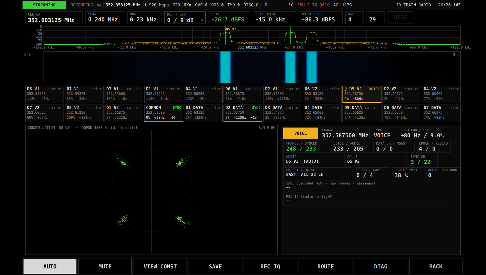
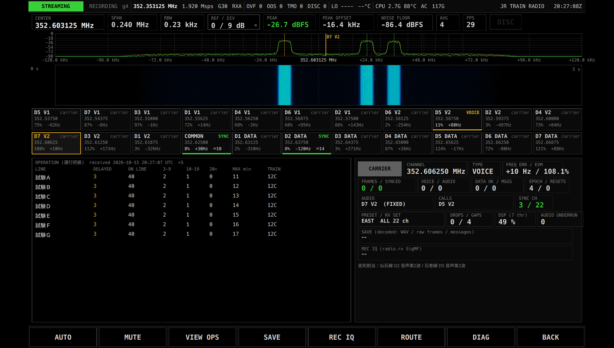

# JR TRAIN RADIO 説明書

JR TRAIN RADIO は、JR 在来線のデジタル列車無線(352.6 MHz 帯、基地局から列車への下り)を受信する App です。
帯域内の全チャネルを同時に受信・復号し、通話の音声を再生しながら、データ電文や運行把握の表を画面に表示します。

> **開発中です。** 実機(B210)で実際の電波を受信しての動作確認は、まだ済んでいません。
> 録音を再生した試験と、原本の実装と同じ結果になることの確認までは済んでいますが、
> 実際の電波で同期・音声・電文が得られるかはこれから確かめます。

復号の処理は、KIRISHIKI Yudai 氏の [jr-conventional-line-radio-receiver](https://github.com/soltia48/jr-conventional-line-radio-receiver) をもとにしています。

> **注意** 電波法第59条により、自分宛てではない無線通信の内容を他人に漏らしたり、窃用したりしてはいけません。受信した音声・電文・保存したファイルの扱いに注意してください。

## できること

- 地域ごとの全チャネル(JR 東日本 22 波、JR 東海 3 波、JR 西日本 19 波)を同時に受信します。
- 通話が始まると、自動でそのチャネルを選んで音声を再生します(`AUTO`)。チャネルを手で選んで固定することもできます。
- 選んだチャネルの受信の質(コンスタレーション)、データ電文の一覧、運行把握の表を切り替えて表示します。
- 路線・区間を選び、その路線のチャネルだけを受信できます(`ROUTE`)。
- 復号した結果(チャネルごとの音声 WAV、無線フレーム、電文)を保存できます(`SAVE`)。
- 受信した電波そのもの(IQ)を録音できます(`REC IQ`)。

## 用意するもの

- 本体(FZ-G2)と USRP B210。
- 350 MHz 帯で使えるアンテナ。受信端子(`RX PORT`)はアンテナをつないだ端子に合わせてください。
- 音声を聞くためのスピーカーまたはイヤホン。
- 地域の設定。受信する地域(プリセット)は画面からは変えられず、`~/spear/site.conf` の `jr_train.preset` で選びます(後述「保存されるデータと設定」)。既定は JR 東日本(`east`)です。

## 起動と終了

1. メニューで `JR TRAIN RADIO` をタップします。受信がすぐに始まります。
2. 終わるときは右下の `BACK` をタップします。メニューに戻り、受信が止まります。保存(`SAVE`)や録音(`REC IQ`)の最中だった場合は、その時点までの内容を確定して止めます。

メニュー、上端のステータスバー、`GAIN` / `RX PORT`、`DIAG` のページ、`BACK`、`EXIT`、数値の入力のしかたは [共通の操作](README.md) を見てください。

ステータスバーに出る周波数は、受信帯域の中心より 250 kHz 低い値です(例: 帯域の中心 352.603125 MHz に対して 352.353125 MHz)。これは受信機の性質上、帯域の真ん中を避けて受けるための設定で、故障ではありません。

## 画面の見かた

画面は上から、帯域スペクトラム、チャネルのタイル、選んだチャネルの詳しい表示(左)と読み出し(右)、ソフトキーの順に並んでいます。

### 帯域スペクトラム(上)

受信している帯域(約 ±120 kHz)のスペクトラムとウォーターフォールです。電波が出ているチャネルは山や縦の帯になって見えます。

| 表示 | 意味 |
|---|---|
| `CENTER` | 帯域の中心周波数。この App では変えられません。 |
| `SPAN` / `RBW` | 表示している幅と、周波数の細かさ。 |
| `REF / DIV` | 表示の上端のレベルと、1 目盛りの dB。**タップできます**(下の「操作」)。 |
| `PEAK` / `PEAK OFFSET` | いちばん強い信号のレベルと、中心からのずれ。 |
| `NOISE FLOOR` | 雑音のレベル。 |
| `AVG` / `FPS` | 平均の回数と、表示の更新回数。`AVG` は枠で囲まれていて、タップするたびに平均回数が 1 → 2 → 4 → 8 → 16 → 1 と変わります |
| `DISC` | 受信データに途切れがあったとき赤く光ります。 |
| 縦線(マーカー) | 各チャネルの位置。琥珀色 = 選んでいるチャネル・通話中、緑 = 同期している、暗い灰色 = それ以外。選んでいるチャネルには名前(例: `D5 V2`)が付きます。 |

### チャネルのタイル(中)

受信している全チャネルが 2 段に並びます。1 枚が 1 チャネルです。

- 左上: チャネルの名前。`D5 V1` は「D5 音声第1波」、`D5 V2` は「D5 音声第2波」、`D1 DATA` は「D1 データ波」、`COMMON` は旅客一斉情報(共用波)です。
- 名前の前の `♪`: 今このチャネルの音声を再生しています。
- 2 行目: 周波数(MHz)。
- 3 行目: 受信の質(EVM、%。小さいほど良い)、周波数のずれ(Hz)、`✉` の後ろはこのチャネルで受けた電文の数です。
- 選んでいるチャネルのタイルは琥珀色の枠で囲まれます。

右上の状態表示と下端の色帯は、次の意味です。

| 表示 | 色 | 意味 |
|---|---|---|
| `VOICE` | 琥珀色 | 通話中(音声を受信している)。 |
| `SYNC` | 緑 | 直近 1 秒以内に無線フレームの同期がとれている。**受信できているかどうかはこれで判断します。** |
| `LOCK` | シアン | フレームの捕捉は続いているが、直近 1 秒の同期は確認できていない。 |
| `carrier` | 灰色 | 搬送波らしきものを捉えている(補助の表示)。 |
| `--` | 灰色 | 何も捉えていない。 |

`carrier` は、何も送信されていないチャネルでも、隣のチャネルの漏れや雑音で出ることがあります。そのときの EVM は 100% 前後の大きな値になります。`carrier` だけでは受信できているとは言えません。

### 選んだチャネルの表示(下の左)

ソフトキーの `VIEW` で 3 つの表示を順に切り替えます。

**`CONST`(コンスタレーション)** — 選んだチャネルの受信点を散布図で描きます。受信がうまくいっていると、点が 4 つの十字(理想の位置)のまわりに集まります。点が円の上に散らばっているときは、信号が弱いか、そのチャネルが空いています。右上の `EVM` は受信の質の数値です。

**`DATA`(受信データ)** — 選んだチャネルで受けた電文の一覧です。新しいものが上に来ます(最大 64 件)。上下にスワイプして送れます。各項目は、1 行目が電文の種類・識別・時刻・受信回数(`×3` なら同じ内容を 3 回受信)、2 行目以降が電文の中身(`項目=値`)です。まだ何もなければ `no messages` と出ます。主な種類は次のとおりです。

| 種類 | 内容 |
|---|---|
| `Presence` / `Registration` / `Transfer` / `Notice` | 在線 / 登録 / 転送 / 通告 |
| `CallSetup` / `ChannelActivity` | 呼設定 / チャネル状況 |
| `MessageDirectory` / `ServiceInformation` / `OperationSummary` | 一覧 / 旅客案内 / 運行把握(共用波) |
| `Unsupported` | 解釈できない電文(中身をそのまま表示) |

**`OPS`(運行把握)** — 共用波で送られる運行把握の表です。どのチャネルを選んでいても、最後に受け取った表を表示します。見出しの `received` の後ろは受信した日時(本体の時計、UTC)、`×` の後ろは同じ内容を受信した回数です。まだ受け取っていなければ `no operation table yet (common channel)` と出ます。

| 列 | 内容 |
|---|---|
| `LINE` | 線区名 |
| `DELAYED` | 遅れている列車の数(0 より大きいと琥珀色) |
| `ON LINE` | 在線している列車の数 |
| `3-9` / `10-19` / `20+` | 遅れが 3〜9 分 / 10〜19 分 / 20 分以上の列車の数 |
| `MAX min` | いちばん大きい遅れ(分) |
| `TRAIN` | 列車番号 |

値が読み取れない欄は `-` になります。表の各欄の意味は電文の解析にもとづくもので、公式の資料で確かめたものではありません。

### 読み出し(下の右)

左上の大きな枠は選んだチャネルの状態で、`VOICE`(琥珀色)/ `FRAME SYNC`(緑)/ `LOCKED`(シアン)/ `CARRIER` / `IDLE`(灰色)のいずれかです。

| 表示 | 意味 |
|---|---|
| `CHANNEL` | 選んだチャネルの周波数。 |
| `TYPE` | チャネルの種類。`VOICE`(音声波)/ `DATA`(データ波)/ `COMMON`(共用波)。 |
| `FREQ ERR / EVM` | 周波数のずれと受信の質。 |
| `FRAMES / SYNCED` | 受けたフレームの数 / そのうち同期がとれた数。 |
| `VOICE / AUDIO` | 音声フレームの数 / 音声にできた数。 |
| `DATA OK / MSGS` | 正しく受けたデータフレームの数 / 電文の数。 |
| `EPOCH / RESETS` | 同期をとり直した区間の番号 / このチャネルの処理を作り直した回数(ふつうは 0)。 |
| `AUDIO` | 今再生しているチャネル。`(AUTO)` は自動選択中、`(FIXED)` は手で固定中。消音中は先頭に `MUTE` が付きます。 |
| `CALLS` | 通話中のチャネルの一覧(始まった順)。 |
| `SYNC CH` | 同期しているチャネルの数 / 受信しているチャネルの数。 |
| `PRESET / RX SET` | 地域(`EAST` / `CENTRAL` / `WEST`)と受信の範囲(`ALL 22 ch` = 全チャネル、`ROUTES 2 -> 5 ch` = 2 区間を選んで 5 チャネル)。 |
| `DROPS / GAPS` | 処理が追いつかずに捨てたデータの数(0 より大きいと赤)/ 受信データの途切れの回数。 |
| `DSP (n thr)` | 復号処理の負荷(80% を超えると赤)。 |
| `AUDIO UNDERRUN` | 音声の出力が途切れた回数。 |
| `SAVE (decoded: ...)` | 復号結果の保存の状態。保存中は赤い文字で、状態・WAV の数と秒数・フレーム数・電文数・保存先を表示します。 |
| `REC IQ (radio.rx SigMF)` | IQ 録音の状態。録音中は赤い `●` と秒数・保存先、止めた後は `last` と最後の録音の長さ・保存先。 |

その下に、必要なときだけ次の行が出ます。

- `SAVE ERROR` / `REC ERROR` / `AUDIO ERROR`: 保存・録音・音声出力の失敗(赤)。
- `PRESET FILE ERROR`: 地域の設定ファイルを読めなかった(赤)。組み込みの設定で動いています。
- 灰色の日本語の行: 選んだチャネルの補足(例: 「変則割当:仙石線 D2 音声第2波 …」。そのチャネルを別の番号の路線でも使っている場合)。

### ソフトキー(下端)

| キー | 動作 |
|---|---|
| `AUTO` | 通話の自動選択の入/切。入のときキーが明るくなります。 |
| `MUTE` | 消音の入/切。受信・保存は続きます。 |
| `VIEW CONST` / `VIEW DATA` / `VIEW OPS` | 下の左の表示を CONST → DATA → OPS → CONST の順に切り替えます。キーには今の表示が出ます。 |
| `SAVE` / `STOP SAVE` | 復号結果の保存を始める / 止める。 |
| `REC IQ` / `STOP REC IQ` | IQ の録音を始める / 止める。 |
| `ROUTE` | 路線から受信するチャネルを選ぶ画面を開きます。路線を選んでいるときはキーが明るくなります。 |
| `DIAG` | 診断のページを開きます([共通の操作](README.md))。 |
| `BACK` | メニューに戻ります。 |

## 操作

### チャネルを選ぶ

- タイルをタップすると、そのチャネルを選びます。選んだチャネルの音声を再生し、下の表示もそのチャネルになります。
- **手で選ぶと `AUTO` が切れて、選択が固定されます**(`AUDIO` 欄に `(FIXED)`)。ほかのチャネルで通話が始まっても切り替わりません。
- 自動選択に戻すには `AUTO` をタップします。

### 通話の自動選択(`AUTO`)

- 通話が始まると、そのチャネルを選んで再生します。表示も再生中のチャネルに合わせて切り替わります。
- 複数の通話があるときは、先に始まった通話を優先します。再生中の通話が終わると、続いている通話のうち始まりが早いものに移ります。
- 1 秒ほど音声が途切れると、その通話は終わったとみなします。
- 通話が無いあいだは、最後に選んでいたチャネルのままです。
- 同時に再生できるのは 1 チャネルだけです。

### 表示のレベルを変える(`REF / DIV`)

帯域スペクトラムの `REF / DIV` をタップすると、表示の上端のレベル(dBFS)を入力する画面が開きます。入力した値が上端になり、そこから 90 dB 下までを表示します(1 目盛り 9 dB)。

### 路線から選ぶ(`ROUTE`)

特定の路線だけを聞きたいときに使います。`ROUTE` をタップすると、画面全体に区間の一覧が開きます。

1. 上の `ALL` / `D1`〜`D7` で、一覧を D 番号(路線に割り当てられた番号)で絞り込みます。`ALL` はすべてです。
2. 一覧の区間(例: `D6  大阪環状線  大阪～大阪`)をタップして選びます。選んだ区間には `✔` が付き、緑の枠になります。もう一度タップすると外れます。各区間の 2 行目は、音声 2 波(`V`)とデータ波(`DATA`)の周波数です。
3. 右側の `SELECTED n → m ch` で、選んだ区間の数と受信することになるチャネルの数を、その下に周波数の一覧を確かめます。
4. `COMMON (旅客一斉情報 / 運行把握)` をタップすると、共用波も受信するかどうか(`ON` / `OFF`)を切り替えます。運行把握の表を見たいときは `ON` にしてください。
5. 下のボタンで確定します。

| ボタン | 動作 |
|---|---|
| `APPLY` | 選んだ区間で受信をやり直します。区間を 1 つも選んでいなければ全チャネルになります。 |
| `CLEAR` | 選んだ区間をすべて外します(まだ確定しません)。 |
| `ALL CHANNELS` | 全チャネルの受信に戻して閉じます。 |
| `CANCEL` | 何も変えずに閉じます。 |

- 同じ周波数を使う別の路線の電波も受信されます。
- 区間の表は原本に収録されたもの(出典: odaQshirei 氏のまとめ)で、現在の運用と同じとは限りません。
- 復号結果の保存(`SAVE`)中に `APPLY` や `ALL CHANNELS` で受信をやり直すと、その時点で保存を区切り、新しいチャネルの組で別のフォルダに保存を始め直します。

### 復号結果を保存する(`SAVE`)

`SAVE` をタップすると保存が始まり、キーが `STOP SAVE` に変わります。もう一度タップすると止めて確定します。
保存中は右下の `SAVE` 欄に、保存した WAV の数と秒数、フレーム数、電文数、保存先が出ます。
再生しているチャネルに関係なく、受信している全チャネルの音声と電文を保存します。`MUTE` も保存には影響しません。

### IQ を録音する(`REC IQ`)

`REC IQ` をタップすると、受信した電波そのものを録音します。`STOP REC IQ` で止めます。
後で同じ受信を再現したり、原因を調べたりするためのものです。1 分あたり約 460 MB と大きいので、空き容量に注意してください。
`SAVE` と同時に使えます。

## 使いかたの例

### 通話を聞く

1. アンテナをつなぎ、メニューで `JR TRAIN RADIO` を開きます。
2. `AUTO` が明るくなっていることを確かめます(暗ければタップ)。
3. 帯域スペクトラムに信号が出て、タイルが `SYNC`(緑)になるのを待ちます。
4. 通話が始まるとタイルが `VOICE`(琥珀色)になり、`♪` が付いて音声が流れます。
5. 音が大きすぎる・静かにしたいときは `MUTE` を使います。

### 特定のチャネルを聞き続ける

1. 聞きたいチャネルのタイルをタップします(`AUDIO` 欄が `(FIXED)` になります)。
2. 自動選択に戻すときは `AUTO` をタップします。

### 運行把握を見る

1. 全チャネル受信、または `ROUTE` で `COMMON` を `ON` にして受信します(JR 東海のプリセットには共用波がありません)。
2. `COMMON` のタイルが `SYNC` になるのを待ちます。
3. `VIEW` を何度かタップして `VIEW OPS` にします。

### 電文を見る

1. データ波(例: `D2 DATA`)や `COMMON` のタイルをタップします。
2. `VIEW` を `VIEW DATA` にします。電文が新しい順に並びます。
3. 自動選択に戻すのを忘れないでください(`AUTO`)。

### 記録をとる

1. 列車の通過や通話がありそうな時間帯に、`SAVE` で復号結果を、必要なら `REC IQ` で IQ も同時に記録します。
2. 数分たったら `STOP SAVE`、`STOP REC IQ` で止めます。
3. 保存先は右下の `SAVE` 欄・`REC IQ` 欄で確かめられます。

## 保存されるデータと設定

### 復号結果(`SAVE`)

保存するたびに、次のフォルダが作られます。

`~/spear/recordings/jr_train/recording-<日時(UTC)>-<番号>/`

| ファイル | 内容 |
|---|---|
| `<周波数>Hz-<番号>.wav` | チャネルごとの音声(8 kHz・16 bit・モノラル)。最初の音声から始まり、5 秒以下の途切れは無音で埋めます。5 秒を超える途切れ、同期のとり直し、30 分ごとに別のファイルに分かれます。 |
| `files.jsonl` | 確定した WAV の一覧(周波数など)。 |
| `raw-frames.jsonl` | 受信した無線フレーム(訂正前)。 |
| `data-messages.jsonl` | 復号した電文。 |
| `session.json` | 保存の設定と、受信したチャネルの一覧。 |
| `result.json` | 終了時の件数とエラー。 |
| `INCOMPLETE` | 保存中の目印。正常に止めると消えます。残っていれば、途中で異常終了したことを示します。 |

`.jsonl` はテキストファイルで、1 行に 1 件ずつ記録されています。書き込みが追いつかないときは保存をエラーで終え、受信は続けます(`SAVE ERROR`)。

### IQ 録音(`REC IQ`)

`~/spear/recordings/jr_train_<地域>_<日時(UTC)>` に SigMF 形式で保存します(`.sigmf-data` = 電波のデータ、`.sigmf-meta` = 周波数や日時などの情報、の 2 ファイル)。例: `jr_train_east_20261016_112233`。

### 次回も覚えている設定

次の項目は終了しても覚えていて、次に開いたときに戻ります(`~/spear/state.conf`)。

- 選んでいたチャネル
- `AUTO` の入/切、`MUTE` の入/切
- 下の左の表示(`CONST` / `DATA` / `OPS`)
- `ROUTE` で選んだ区間と `COMMON` の入/切
- 帯域スペクトラムの表示レベル(`REF / DIV`)と平均の設定

### site.conf で決める設定

次の項目は画面からは変えられません。`~/spear/site.conf` に `キー=値` の形で書きます。

| キー | 既定 | 内容 |
|---|---|---|
| `jr_train.preset` | `east` | 地域。`east` = JR 東日本(22 波、帯域中心 352.603125 MHz)、`central` = JR 東海(3 波、352.625 MHz)、`west` = JR 西日本(19 波、352.603125 MHz)。 |
| `jr_train.save_audio` | `1` | `SAVE` で音声 WAV を保存する(`0` で保存しない)。 |
| `jr_train.save_raw` | `1` | `SAVE` で無線フレームを保存する。 |
| `jr_train.save_messages` | `1` | `SAVE` で電文を保存する。 |
| `jr_train.presets_file` | なし | 地域とチャネルの定義を外部のファイルから読む場合のファイル名。 |

## 困ったとき

| 症状 | 原因 | 対処 |
|---|---|---|
| どのタイルも `SYNC` にならない | 電波が届いていない、アンテナや端子が合っていない、地域の設定が違う | アンテナの接続と `RX PORT` を確かめる。見通しのよい場所・線路の近くに移る。`PRESET / RX SET` の地域が合っているか確かめる(`jr_train.preset`)。 |
| スペクトラムに信号が見えるのに `SYNC` にならない | 信号が弱い、`GAIN` が合っていない、本体の周波数のずれが大きい | `GAIN` を調整する。`FREQ ERR` がいつも数百 Hz(±500 Hz 近く)になるときは、本体の周波数のずれの補正(`radio.freq_err_ppm`)を確かめる。 |
| ほとんどのタイルが `carrier` になっている | 空きチャネルでも雑音や隣の電波で出る補助の表示 | 異常ではありません。`SYNC` / `VOICE` で判断してください。 |
| `VOICE` になっているのに音が出ない | `MUTE` が入っている、別のチャネルに固定している、音声出力の失敗 | `AUDIO` 欄を確かめる。`MUTE` を切る。`AUTO` を入れる。`AUDIO ERROR` が出ていれば音声の出力先を確かめる。 |
| 聞きたい通話に切り替わらない | `AUTO` が切れている(タイルをタップした)、先に始まった通話を再生している | `AUTO` を入れる。別の通話を聞くときは、そのタイルをタップする。 |
| 音が途切れる | 処理が追いつかない、受信が弱い | `DSP` の負荷、`DROPS / GAPS`、`AUDIO UNDERRUN` を確かめる。本体が熱くなっていないか確かめる。 |
| `OPS` に表が出ない | 共用波を受信していない、まだ届いていない | `ROUTE` で `COMMON` を `ON` にする。`COMMON` のタイルが `SYNC` になるまで待つ。JR 東海には共用波がありません。 |
| `DATA` が `no messages` のまま | 選んでいるチャネルで電文を受けていない | データ波や `COMMON` のタイルを選ぶ。タイルの `✉` の数を見て、電文のあるチャネルを選ぶ。 |
| `SAVE` が勝手に止まった | 書き込みが追いつかなかった、空き容量が足りない | もう一度 `SAVE` をタップする。`SAVE ERROR` が出ていれば空き容量を確かめる。 |
| `REC ERROR  dropped … blocks` | 録音の書き込みが追いつかなかった | 空き容量と記録先を確かめ、ほかの重い作業を止めて録り直す。 |
| `PRESET FILE ERROR` が出る | `jr_train.presets_file` のファイルが読めない、内容に誤りがある、`jr_train.preset` の名前が違う | 表示されたメッセージに従ってファイルや設定を直す。それまでは組み込みの設定で動いています。 |
| `DROPS / GAPS` が赤い | 処理が追いつかずデータを捨てた | 本体の負荷・温度を確かめる。AC 電源で使う。 |

## 制限事項

- **開発中で、実際の電波での受信はまだ確かめていません。** 実地で使えるかどうか、ゲインなどの適切な設定は、これから確かめます。
- 受信できるのは基地局から列車への下りだけです。列車からの上りは受信しません。
- 音声を同時に再生できるのは 1 チャネルだけです(保存は全チャネル)。
- 音声は受信から少し遅れて聞こえます。
- 地域(プリセット)、受信の中心周波数、保存する内容は画面からは変えられません(site.conf)。
- `ROUTE` の区間の表は原本に収録されたもので、現在の運用を保証しません。同じ周波数を使う別の路線の電波も受信します。
- `OPS` の受信日時は本体の時計で受け取った時刻(UTC)で、電文が作られた時刻ではありません。表の各欄の意味は電文の解析にもとづくものです。
- 全チャネルを同時に処理するため、本体の負荷と温度が高くなります。バッテリー駆動や夏の屋外での長時間の使用はまだ確かめていません。
- IQ 録音は 1 分あたり約 460 MB になります。
