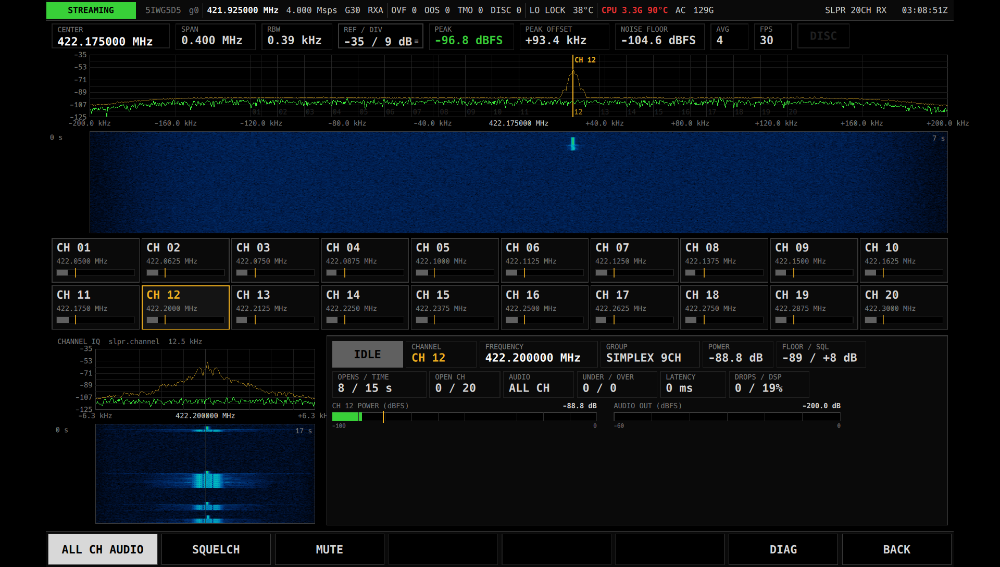

# SLPR 20CH RX 説明書

SLPR 20CH RX は、422 MHz 帯の特定小電力トランシーバー(単信 20 チャネル)を **20 チャネル同時に受信して音声で聞く** ためのアプリです。
チャネルを切り替えながら探す必要はありません。どのチャネルで電波が出ているかが一目でわかり、出ているチャネルの音声がそのまま流れます。

画面全体の操作(メニュー、ステータスバー、GAIN / RX PORT、DIAG ページ、BACK、EXIT、数値入力のしかた)は [共通の操作](README.md) を見てください。

> 注意: 受信した通信の内容を他人に漏らしたり、悪用したりしないでください(電波法第 59 条)。

## できること

- 特定小電力トランシーバーの単信チャネル 01–20(422.0500–422.3000 MHz)を同時に受信します。
- 電波が出ているチャネルを緑色で示します。何チャネル同時に出ていても見えます。
- 音声は「電波が出ている全チャネルを混ぜて聞く」か「選んだ 1 チャネルだけ聞く」かを選べます。
- 選んだチャネルの強さ・雑音の床・開いた回数と時間などを数字で確認できます。
- スケルチ(電波が無いときに雑音を鳴らさない仕組み)の感度を変えられます。

受信だけのアプリです。送信はしません。

## 用意するもの

- 本体(タブレット)と USRP B210。
- **422 MHz 帯に合ったアンテナ**。B210 の受信端子(`RX PORT` で選んだ端子)につなぎます。
- 音声を聞くためのスピーカーまたはイヤホン。音量は OS 側で調整します(アプリに音量の操作はありません)。

## 起動と終了

1. メニューの一覧から `SLPR 20CH RX` をタップします。
2. 受信が始まると、ステータスバーが `STREAMING` になり、画面に 20 チャネルの状態が出ます。
3. 終わるときは右下の `BACK` を押します。メニューに戻り、受信も止まります。

周波数やサンプルレートを設定する必要はありません。受信する周波数はチャネル表でアプリが決めています。
なお、ステータスバーの周波数は `421.925000 MHz` のように、帯域の中心(422.1750 MHz)より 250 kHz 低い値になります。これは受信機の都合でわざとずらしているもので、故障ではありません。

## 画面の見かた

画面は上から「帯域スペクトラム」「チャネル格子」「選択チャネルの詳細」の 3 段です。

### 上段: 帯域スペクトラム

20 チャネル全体(422.175 MHz を中心に ±200 kHz)の電波の様子です。上がスペクトラム(横軸 = 周波数、縦軸 = 強さ)、下がウォーターフォール(時間の流れ。新しいものが上)です。

- スペクトラムの下側に `01`〜`20` のチャネル位置の目印があります。いま選んでいるチャネルは琥珀色の縦線と `CH 12` のようなラベルで示します。
- 電波が出ていると、そのチャネルの位置に山が立ち、ウォーターフォールに明るい筋が出ます。
- 上の読み出し行:

| 表示 | 意味 |
|---|---|
| `CENTER` | 表示の中心周波数(422.175000 MHz)。このアプリでは変更できません |
| `SPAN` | 表示している周波数の幅 |
| `RBW` | 周波数の細かさ(分解能) |
| `REF / DIV` | 縦軸のいちばん上の値 / 1 目盛りの dB。**タップすると上端の値を入力できます** |
| `PEAK` / `PEAK OFFSET` | いちばん強い所の強さと、中心からの周波数のずれ |
| `NOISE FLOOR` | 雑音の床の高さ |
| `AVG` / `FPS` | 表示の平均回数 / 表示の更新回数(毎秒) |
| `DISC` | 受信データに途切れがあったとき赤く点きます |

### 中段: チャネル格子

20 チャネルを 2 段 × 10 個のカードで並べています。上段が `CH 01`〜`CH 10`、下段が `CH 11`〜`CH 20` です。

各カードの見かた:

- 左上: チャネル番号(`CH 01` など)。
- その下: 周波数(`422.0500 MHz` など)。
- 下のバー: そのチャネルの電波の強さ(左端 −100、右端 −20)。
  - 灰色 = 電波なし(スケルチ閉)、**緑 = 電波あり(スケルチ開)**。
  - 琥珀色の小さな縦線 = スケルチが開く基準の高さ。バーがこの線を超えると開きます。基準は雑音の床に合わせて自動で動きます。
- 右上の緑の数字: 電波が出ている間だけ、その強さ(dBFS)を出します。
- **琥珀色の枠のカードが、いま選んでいるチャネル**です。

カードをタップすると、そのチャネルを選びます(操作音が鳴ります)。

### 下段: 選択チャネルの詳細

左は選んだチャネルだけを拡大したスペクトラムとウォーターフォール(`CHANNEL IQ  slpr.channel  12.5 kHz`。幅 12.5 kHz)です。縦軸の範囲は上段の帯域スペクトラムと同じになります。

右は数字の読み出しです。

| 表示 | 意味 |
|---|---|
| `CARRIER` / `IDLE` | 選んだチャネルの状態。緑の `CARRIER` = 電波あり、灰色の `IDLE` = 電波なし |
| `CHANNEL` | 選んでいるチャネル番号 |
| `FREQUENCY` | その周波数 |
| `GROUP` | 区分。`SIMPLEX 11CH`(ch01–11)または `SIMPLEX 9CH`(ch12–20) |
| `POWER` | そのチャネルの電波の強さ(dB) |
| `FLOOR / SQL` | 雑音の床 / スケルチの余裕。例 `-89 / +8 dB` は「床 −89 dB より 8 dB 強ければ開く」 |
| `OPENS / TIME` | このチャネルが開いた回数 / 開いていた合計秒数(アプリを起動してからの累計) |
| `OPEN CH` | いま電波が出ているチャネルの数 / 20。1 つ以上あると緑 |
| `AUDIO` | 音声の出かた。`ALL CH` = 全チャネルを混ぜて再生、`CH 12` など = そのチャネルだけ、`MUTE` = 消音中、`ERROR`(赤)= 音声が出せない |
| `UNDER / OVER` | 音声の途切れ / あふれの回数。0 以外だと琥珀色 |
| `LATENCY` | 音声の遅れ(ミリ秒) |
| `DROPS / DSP` | 受信データの取りこぼし回数(0 以外だと赤)/ 処理の負荷(%) |
| `CH xx POWER (dBFS)` | 選んだチャネルの強さのバー。琥珀色の線がスケルチの開く基準 |
| `AUDIO OUT (dBFS)` | スピーカーに出している音声の大きさ(水色のバー) |

音声が出せないときは、その下に赤い文字で `AUDIO ERROR` と理由が出ます。

## 操作

| キー | 動作 |
|---|---|
| `ALL CH AUDIO` | 押すたびに切り替わります。点灯(明るい表示)中は、電波が出ている全チャネルの音声を混ぜて流します。消灯中は、選んだチャネルの音声だけを流します。最初は点灯です |
| `SQUELCH` | スケルチの余裕を数値で入力します(画面の題名は `SQUELCH  MARGIN ABOVE NOISE FLOOR`、0〜40 dB、整数)。確定するとすぐに効きます |
| `MUTE` | 押すたびに消音 / 解除を切り替えます。点灯中は音が出ません(受信と表示は続きます) |
| `DIAG` | DIAG ページを開きます |
| `BACK` | アプリを終了してメニューに戻ります |

画面の中でタップできる所:

| 場所 | 動作 |
|---|---|
| チャネル格子のカード | そのチャネルを選びます。下段の詳細、上段の琥珀色の目印、`ALL CH AUDIO` 消灯時に聞こえるチャネルが切り替わります |
| 上段の `REF / DIV` | スペクトラム縦軸の上端(dBFS)を入力します。下段のチャネル拡大表示も同じ範囲になります |

### スケルチについて

電波が出ていないチャネルの雑音を鳴らさないために、チャネルごとにスケルチがかかっています。

- 開く基準は「雑音の床 + 余裕」です。雑音の床は 20 チャネル全体のまん中ぐらいの強さから自動で決まるので、周りの雑音が変わっても基準が追いかけます。
- 余裕の初期値は 8 dB です。`SQUELCH` で変えられます。
  - 値を **小さく** すると、弱い電波でも開きやすくなります(雑音で開くことも増えます)。
  - 値を **大きく** すると、強い電波だけで開くようになります(遠くの弱い局は聞こえにくくなります)。
- 一瞬の雑音では開かず、閉じるときも会話の息継ぎ程度では切れないようにしてあります。
- 電波が出て開くと、DIAG ページの `EVENT LOG` に `ch12 carrier`、閉じると `ch12 clear` のような記録が残ります。

## チャネル表

チャネル番号は ICOM 準拠の通し番号 01–20 です。間隔は 12.5 kHz で、ch11 と ch12 の間だけ 25 kHz あきます。

| ch | 周波数 (MHz) | 区分(`GROUP`) |
|---|---|---|
| 01 | 422.0500 | `SIMPLEX 11CH` |
| 02 | 422.0625 | `SIMPLEX 11CH` |
| 03 | 422.0750 | `SIMPLEX 11CH` |
| 04 | 422.0875 | `SIMPLEX 11CH` |
| 05 | 422.1000 | `SIMPLEX 11CH` |
| 06 | 422.1125 | `SIMPLEX 11CH` |
| 07 | 422.1250 | `SIMPLEX 11CH` |
| 08 | 422.1375 | `SIMPLEX 11CH` |
| 09 | 422.1500 | `SIMPLEX 11CH` |
| 10 | 422.1625 | `SIMPLEX 11CH` |
| 11 | 422.1750 | `SIMPLEX 11CH` |
| 12 | 422.2000 | `SIMPLEX 9CH` |
| 13 | 422.2125 | `SIMPLEX 9CH` |
| 14 | 422.2250 | `SIMPLEX 9CH` |
| 15 | 422.2375 | `SIMPLEX 9CH` |
| 16 | 422.2500 | `SIMPLEX 9CH` |
| 17 | 422.2625 | `SIMPLEX 9CH` |
| 18 | 422.2750 | `SIMPLEX 9CH` |
| 19 | 422.2875 | `SIMPLEX 9CH` |
| 20 | 422.3000 | `SIMPLEX 9CH` |

メーカーによってはチャネルの呼び方(番号)が違うことがあります。周波数で照らし合わせてください。中継用のチャネル(440 MHz 帯)は受信しません。

## 使いかたの例

### 会場で使われているチャネルを探す

1. 422 MHz 帯のアンテナをつなぎ、`SLPR 20CH RX` を起動します。
2. `ALL CH AUDIO` が点灯していることを確認します。どのチャネルでも電波が出れば音が鳴ります。
3. 音が鳴ったら、チャネル格子で緑になっているカードを見ます。そこが使われているチャネルです。
4. しばらく置いておき、各カードをタップして `OPENS / TIME` を見ると、どのチャネルがよく使われているかがわかります。

### 特定のチャネルだけを聞く

1. 聞きたいチャネルのカードをタップして選びます(琥珀色の枠になります)。
2. `ALL CH AUDIO` を押して消灯させます。`AUDIO` の表示が `CH 05` などに変わります。
3. ほかのチャネルで電波が出ても、表示は緑になりますが音は鳴りません。

### 雑音で開いてしまうとき / 弱い局を拾いたいとき

1. `SQUELCH` を押し、余裕の値を入力します(例: 雑音で開くなら 12、弱い局を拾いたいなら 5)。
2. カードの琥珀色の線(開く基準)が動きます。電波の無いチャネルのバーが線を超えない、ちょうどよい値にします。

## 保存される設定

次の設定は、アプリを終了しても次回の起動時に戻ります。

- スケルチの余裕(`SQUELCH` の値)
- 選んでいたチャネル
- `MUTE` の状態
- `ALL CH AUDIO` の状態
- 帯域スペクトラムの縦軸の範囲(`REF / DIV`)などの表示設定

`OPENS / TIME` の回数と時間は保存されません。起動するたびに 0 から数えます。

## 困ったとき

| 症状 | 原因 | 対処 |
|---|---|---|
| どのチャネルも緑にならない | 近くで特定小電力トランシーバーが使われていない / アンテナや受信端子が違う / 受信ゲインが低い | 帯域スペクトラムに山が立つか確認します。アンテナの接続と `RX PORT`、`GAIN` を見直します([共通の操作](README.md)) |
| 電波が無いのにカードがときどき緑になり、雑音が鳴る | スケルチの余裕が小さい | `SQUELCH` で値を大きくします |
| スペクトラムに山は見えるのに開かない | 電波が弱く、開く基準(琥珀色の線)に届いていない | `SQUELCH` で値を小さくするか、`GAIN` やアンテナを見直します |
| 緑になっているのに音が出ない | `MUTE` が点灯している / `ALL CH AUDIO` が消灯していて、別のチャネルを選んでいる | `AUDIO` の表示を見て、`MUTE` を解除するか、`ALL CH AUDIO` を点灯させるか、そのチャネルを選びます |
| `AUDIO` が `ERROR` になり、赤い `AUDIO ERROR` が出る | 音声の出力先が使えない | スピーカー / イヤホンの接続と OS の音声設定を確認し、アプリを起動し直します |
| 音が小さい / 大きい | アプリに音量の操作はありません | OS 側の音量で調整します |
| 音がプツプツ切れる(`UNDER / OVER` が増える) | 音声の出力が追いついていない | ほかの重い処理を止めます。続く場合はアプリを起動し直します |
| `DROPS / DSP` の左側の数字が赤く増える | 受信データを取りこぼしている(本体の処理が追いつかない) | ほかのアプリや重い処理を止めます。DIAG ページで状態を確認します |
| 複数の局が同時に話すと音が割れる | 全チャネルの音声を混ぜているため | `ALL CH AUDIO` を消灯して、聞きたいチャネルだけにします |
| ステータスバーの周波数が 421.925 MHz になっている | 正常です(受信機の都合で中心から 250 kHz ずらしています) | 対処は不要です |

## 制限事項

- 受信するのは単信の 20 チャネル(422.0500–422.3000 MHz)だけです。中継用(440 MHz 帯)は受信しません。
- 受信周波数やチャネル表は画面から変更できません。
- グループトーク(CTCSS / DCS のトーンやコード)による呼び分けはしません。同じチャネルの音声はすべて聞こえます。
- 音量の調整はアプリにはありません。OS 側で行います。
- スケルチの基準は 20 チャネル全体の雑音の床から決めます。半分以上のチャネルで同時に電波が出ていると基準が上がり、弱い局で開きにくくなることがあります。
- `ALL CH AUDIO` で複数のチャネルが同時に鳴ると、音声は混ざって聞こえ、大きいと割れることがあります。
- 送信はできません。受信だけです。
