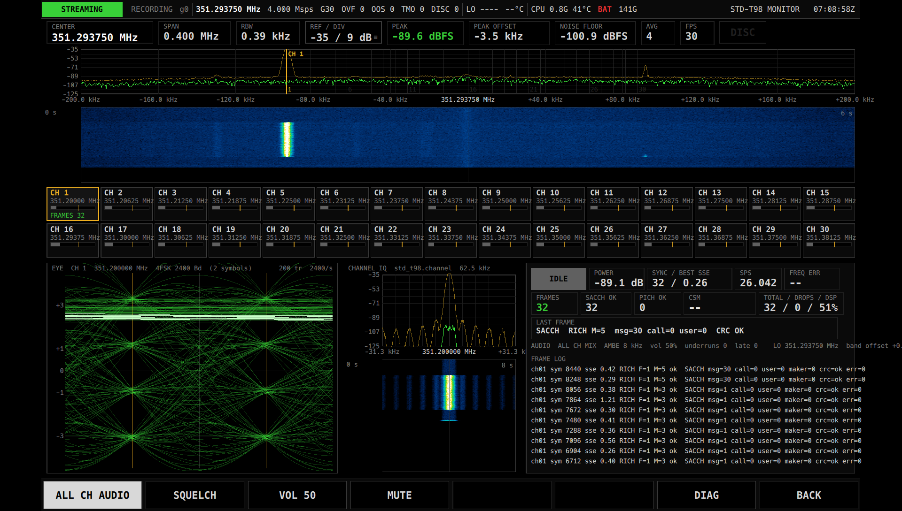

# STD-T98 MONITOR 説明書

STD-T98 MONITOR は、351 MHz 帯のデジタル簡易無線(ARIB STD-T98、4 値 FSK)の 30 チャネルを同時に受信し、
フレームの内容と音声をモニタする App です。音声は全チャネルを混ぜて聞くことも、1 チャネルだけを聞くこともできます。
秘話の呼は鍵を自動で探し、見つかれば音声を復号します。

共通の操作(メニュー、ステータスバー、GAIN / RX PORT、DIAG ページ、BACK、EXIT、数値入力)は [共通の操作](README.md) を参照してください。



(画面写真は以前の版のもので、今の画面と細部が違うことがあります。この説明書は今の版に合わせています。)

## できること

- 351.20000〜351.38125 MHz(6.25 kHz 間隔、ch1〜ch30)を、選局せずに全部同時に受信します。
- 帯域全体のスペクトラムとウォーターフォールで、どのチャネルに電波が出ているかを一目で見られます。
- チャネルごとにフレーム同期の有無(緑の帯と `SYNC`)と、最後に受信した無線機の識別番号(`CSM`)を表示します。
- 選んだチャネルについて、アイパターン、チャネル内のスペクトラム、受信の統計、最後のフレームの内容を表示します。
- 音声(AMBE)を再生します。全チャネルを混ぜて聞く(`ALL CH AUDIO`)か、選んだ 1 チャネルだけを聞くかを選べます。
- 秘話の呼の鍵を自動で探し、見つかった鍵で音声を復号します。鍵は呼をまたいで覚えておきます。

## 用意するもの

- 本機(FZ-G2)と USRP B210(または互換機)。
- 351 MHz 帯に合ったアンテナ。アンテナをつないだ端子を、メニューの `RX PORT` で選んでおきます([共通の操作](README.md))。
- 音声を聞く場合はスピーカーかヘッドホン。音声はシステムの既定の出力に出ます。

受信周波数とサンプルレート(4 Msps)はこの App が決めます。周波数を手で変える操作はありません。
ステータスバーの中心周波数は 351.04375 MHz(帯域の中心 351.29375 MHz より 250 kHz 低い値)になりますが、これは正常です
(受信機が出す中心の雑音を ch16 に重ねないため、わざとずらしています)。

この 30 チャネル以外の周波数は受信しません。

## 起動と終了

1. 必要ならメニューで `GAIN`(または AGC)と `RX PORT` を設定します。`RX PORT` は App を起動したときに反映されます。
2. メニューの一覧から `STD-T98 MONITOR` をタップします。
3. 数秒で受信が始まり、電波の出ているチャネルがスペクトラムに現れます。
4. 終わるときは右端の `BACK` でメニューに戻ります。

## 画面の見かた

画面は上から順に、帯域スペクトラム、チャネル格子、選択チャネルの詳細の 3 段です。表示は 1 秒に 5 回ほど更新されます。

### 帯域スペクトラム(上段)

30 チャネル全体(幅 400 kHz)のスペクトラムと、その下にウォーターフォール(時間の流れ)を表示します。

- 縦の細線がチャネルの位置です。1, 6, 11, 16, 21, 26, 30 に番号が付きます。
- 琥珀色の太い線と `CH n` が、いま選んでいるチャネルです。
- 上の読み出し行:

| 表示 | 意味 |
|---|---|
| `CENTER` | 帯域の中心周波数(351.29375 MHz)。この App では変更できません |
| `SPAN` / `RBW` | 表示している幅と、周波数の細かさ |
| `REF / DIV` | 縦軸の上端のレベルと 1 目盛りの dB。**タップすると上端のレベルを入力できます**(下記「操作」) |
| `PEAK` / `PEAK OFFSET` | いちばん強い信号のレベルと、その中心からの位置 |
| `NOISE FLOOR` | 雑音の床のレベル |
| `AVG` / `FPS` | 平均回数と、表示の更新回数 |
| `DISC` | 受信データが途切れたときに赤く点きます |

### チャネル格子(中段)

30 チャネルを 15 列 × 2 段の升目で表示します。升目をタップするとそのチャネルを選びます。選んだ升目は琥珀色の枠になります。

| 表示 | 意味 |
|---|---|
| `CH n` | チャネル番号 |
| `SYNC`(緑の文字)と緑の帯 | そのチャネルでフレーム同期が取れている(デジタル簡易無線の信号を受信できている)ことを示します。同期が切れてからも 1 秒間は表示を残します |
| 灰色の帯 | 同期が取れていない(送信がない、または弱くて受信できない) |
| `CSM ...` | 最後に正しく受信できた識別番号(無線機の呼出名称記憶装置が自動で送る番号)。まだ受信していなければ、そのチャネルの周波数を表示します |

活動の判定は電波の強さではなく、フレーム同期だけで行います。雑音や無変調の電波では緑になりません。
逆に、弱くても同期が取れていれば緑になります。

### 選択チャネルの詳細(下段)

#### `EYE`(左)

選んだチャネルのアイパターンです。タイトルにチャネル番号、周波数、`4FSK 2400 Bd` を表示し、右上に重ねた本数と 1 秒あたりの本数を表示します。

- 横線は 4 つの信号レベル(`+3` `+1` `-1` `-3`)と 0、琥珀色の縦線は値を読み取る位置です。
- 受信状態が良いと、琥珀色の縦線の位置で線が 4 つのレベルにきれいに集まり、その間に「目」が開いて見えます。
  線がぼやけて目が閉じているときは、信号が弱いか、雑音や混信があります。
- 同期が取れている間だけ描きます。チャネルを選び直したときと、受信が終わったときに消えます。

#### `CHANNEL IQ`(中央)

選んだチャネルの周辺(幅 62.5 kHz)のスペクトラムとウォーターフォールです。縦軸のレベルは帯域スペクトラムと同じ設定に従います。

#### 読み出し(右)

1 段目:

| 表示 | 意味 |
|---|---|
| `SYNC` / `IDLE` | 緑の `SYNC` = 受信中、灰色の `IDLE` = 受信していない(格子の緑と同じ判定) |
| `POWER` | チャネルの電力(dB)。目安の数値で、受信の判定には使いません |
| `SYNC / BEST SSE` | 同期の合図(同期語)を見つけた回数 / これまでで最も一致が良かったときのずれの大きさ。ずれは小さいほど信号がきれいです |
| `SPS` | 1 シンボルあたりのサンプル数の推定値。正常に受信していると 26.0 前後で安定します |
| `FREQ ERR` | 受信している電波の周波数のずれの推定値(Hz)。受信中だけ表示します |

2 段目:

| 表示 | 意味 |
|---|---|
| `FRAMES` | このチャネルで取り出したフレームの数 |
| `SACCH OK` / `PICH OK` | 制御情報が誤りなく読めたフレームの数(通話中のフレームと、呼の始めなどに出るフレーム) |
| `LOCK / FLY / DROP` | 同期をつかんだ回数(送信の回数にほぼ一致) / 同期の合図が崩れていたが、前後の位置から推定して取り出したフレームの数 / 雑音などで捨てた候補の数 |
| `CSM` | 最後に正しく受信した識別番号 |
| `TOTAL / DROPS / DSP` | 全チャネルのフレームの合計 / 処理が追いつかずに受信データを取りこぼした回数(1 以上で赤) / 処理の負荷(%) |

3 段目:

| 表示 | 意味 |
|---|---|
| `SECRET` | 秘話の状態と鍵(次の「秘話の呼について」) |
| `LAST FRAME` | 最後に受信したフレームの種類(`PICH` / `SACCH`)と中身。`call=` が 1 なら秘話の呼、`user=` は無線機に設定されたユーザーコードです。誤りがあると `CRC BAD`(赤)、誤りがなければ `CRC OK` |

音声の出力に失敗したときは、読み出しの下に赤い `AUDIO ERROR` と理由を表示します。このときも受信と表示は続きます。

## 操作

画面下のソフトキー:

| キー | 動作 |
|---|---|
| `ALL CH AUDIO` | 点灯中は全チャネルの音声を混ぜて再生します。消灯中は選んだチャネルの音声だけを再生します。タップで切り替え |
| `MUTE` | 点灯中は音を消します(受信と表示は続きます)。タップで切り替え |
| `DIAG` | 診断ページを開きます([共通の操作](README.md))。イベントログに、受信したフレームの 1 行記録と、鍵が見つかったときの記録(`secret chN key K ...`)が残ります |
| `BACK` | メニューに戻ります |

画面のタップ:

| 場所 | 動作 |
|---|---|
| チャネル格子の升目 | そのチャネルを選びます。下段の表示と、`ALL CH AUDIO` 消灯時の音声がそのチャネルに切り替わります |
| 帯域スペクトラムの `REF / DIV` | 縦軸の上端のレベル(dBFS)を入力します。下端は上端の 90 dB 下になります |

チャネルを選ぶキー(CH−/CH+)や、周波数を変えるキーはありません。

音声は受信から約 0.3 秒遅れて出ます(複数のチャネルの音声を時刻どおりに並べるため)。

## 秘話の呼について

秘話の呼(`LAST FRAME` の `call=1`)を受信すると、App は自動で鍵を探します。操作は要りません。

1. 秘話の呼を受信すると、まず数フレーム(約 0.4 秒分)を集めます。
2. 前に見つけた鍵があれば、まずそれを試します。他のチャネルで見つけた鍵も試します。
3. 合わなければ全部の鍵を探します。1 回の探索には 1 秒前後かかります。
4. 見つかると、それ以降のその呼の音声を復号して再生します。呼の途中でも定期的に鍵を確かめ直します。

鍵が見つかるまでの間、秘話の音声はスクランブルされたまま(意味の取れない音)で鳴ります。
音声を聞いていないチャネルでも探索は行うので、あとでそのチャネルを選んだときにすぐ復号できます。

`SECRET` の表示:

| 表示 | 意味 |
|---|---|
| `clear`(淡い色) | 秘話ではない呼、または受信していない |
| `clear  (last K n)` | 今は秘話ではない。このチャネルで前に使った鍵は n |
| `COLLECTING`(琥珀) | 秘話の呼。探索のためのフレームを集めている |
| `SEARCHING`(琥珀) | 鍵を探している |
| `KEY n`(緑) | 鍵 n で復号している。後ろに `...` が付くのは、鍵を確かめ直している最中です |
| `MISS`(赤) | 鍵が見つからなかった。呼が続いていれば、フレームがたまったあとで探し直します |

鍵は App を止めるまで覚えています。App を起動し直すと、鍵の記憶は消えます。

> **注意** 電波法第 59 条により、自分宛てではない無線通信の存在や内容を漏らしたり、窃用したりしてはいけません。
> また、電波法第 109 条の 2 により、暗号通信を受信した者が、その内容を漏らしたり窃用したりする目的で内容を復元することは禁止されています。
> 秘話の復号は、自分の無線機による動作確認など、法令に反しない範囲で使ってください。

## 使いかたの例

### 全チャネルを聞き流す

1. メニューで `STD-T98 MONITOR` を起動します。
2. `ALL CH AUDIO` が点灯していることを確かめます(点灯していなければタップ)。
3. どこかのチャネルで送信があると、格子のそのチャネルが緑になり、音声が流れます。

### 1 つのチャネルだけを聞く

1. チャネル格子で聞きたいチャネルの升目をタップします。
2. `ALL CH AUDIO` をタップして消灯させます。
3. 選んだチャネルの音声だけが流れます。他のチャネルの受信と表示は続きます。

### 受信状態を確かめる

1. 確かめたいチャネルを格子で選びます。
2. 送信があるときに `EYE` を見て、4 つのレベルに線が集まっているかを確かめます。
3. `SACCH OK` が `FRAMES` に近いほど誤りが少ない状態です。`LAST FRAME` に `CRC BAD` が多いときは、アンテナや設置場所、`GAIN` を見直します。

### 自分の無線機で秘話を確かめる

1. 無線機を秘話に設定し、送信するチャネルを格子で選びます。
2. 送信すると `SECRET` が `COLLECTING` → `SEARCHING` → `KEY n` と変わり、音声が復号されます。
3. 同じ鍵で次に送信したときは、最初に前の鍵を試すので、すぐに復号が始まります。

## 保存される設定

次の設定は App を終了しても覚えていて、次に起動したときに元に戻ります。

- 選んでいるチャネル
- `MUTE` のオン / オフ
- `ALL CH AUDIO` のオン / オフ
- 帯域スペクトラムの縦軸のレベル(`REF / DIV` で設定した値)と平均回数

秘話の鍵、受信の統計(`FRAMES` などの数)は保存しません。App を起動するたびに 0 から始まります。

## 録音の解析

必要な場合だけ使う機能です。IQ RECORDER で録音したファイルを、パソコン上で解析して、チャネルごとの音声を WAV ファイルに書き出せます。
秘話の呼は App と同じ方法で鍵を探して復号します。

1. IQ RECORDER で、レート 4 Msps で録音します(録音は `~/spear/recordings/` に入ります)。
2. 端末で次のように実行します。

```
./build/tools/spear-std-t98-decode ~/spear/recordings/<録音名> --freq-err <値> --wav ~/spear/audio/<録音名>
```

- `<値>` は、帯域の中心(351.29375 MHz)と録音の中心周波数との差(Hz)です。
  - 録音の中心を 351.29375 MHz にした場合は `0`。
  - STD-T98 MONITOR と同じ中心周波数(351.04375 MHz)で録音した場合は `250000`。
- チャネルごとに `<録音名>.chNN.wav` ができます。画面には 30 チャネル分のフレームの一覧が出ます。
- 秘話の鍵を探さずにそのまま書き出すときは `--no-secret` を付けます。

## 困ったとき

| 症状 | 原因 | 対処 |
|---|---|---|
| どのチャネルも緑にならない | 送信がない / アンテナの端子の選択が違う / ゲインが低すぎる | 近くで送信して確かめます。メニューの `RX PORT` がアンテナをつないだ端子か確かめ、`GAIN` を見直します |
| スペクトラムに信号は見えるが緑にならない | 信号が弱い、混信がある、またはデジタル簡易無線以外の電波 | アンテナの位置を変えます。電波の強さだけでは緑になりません |
| 音が出ない | `MUTE` が点灯している / `ALL CH AUDIO` が消灯していて、選んだチャネルに送信がない | `MUTE` を消します。`ALL CH AUDIO` を点灯させるか、送信のあるチャネルを選びます |
| 音が出ず `AUDIO ERROR` が出ている | 音声の出力先が使えない | スピーカーやヘッドホンの接続、システムの音声設定を確かめ、App を起動し直します |
| 意味の取れない音が鳴る | 秘話の呼で、鍵がまだ見つかっていない | `SECRET` を見ます。鍵が見つかれば復号されます。`MISS` のままのときは、信号の質(`CRC BAD` の多さ)を見直します |
| 音声がときどき途切れる | 信号が弱い、雑音が多い | アンテナの位置を変えます。強い雑音のある場所では、AGC をやめて手動のゲインも試します |
| `TOTAL / DROPS / DSP` の DROPS が赤い | 処理が追いつかず受信データを取りこぼした | 他の重い処理を止めます。`DSP` が 100% 近くのときは処理能力が足りていません |
| `DISC` が赤く点く | 受信データが途切れた | DIAG ページで装置の状態を確かめます([共通の操作](README.md)) |

## 制限事項

- 受信するのは 351 MHz 帯の ch1〜ch30 だけです。他の周波数は受信しません。
- 受信専用です。送信はできません。
- 受信周波数とサンプルレートは固定で、変更できません。
- `CSM` は最後に正しく受信した値を表示します。そのチャネルで今送信している局のものとは限りません。
- 秘話の鍵が必ず見つかるとは限りません。信号の質が悪いと見つからないことがあります。
- 秘話の復号は、自分でスクランブルした音声の録音では確かめてありますが、実際の無線機が秘話で送信した電波ではまだ確かめていません。
- 秘話の鍵、受信の統計は App を止めると消えます。
- 画面上の受信記録はイベントログ(DIAG)だけで、この App には録音の機能はありません。録音は IQ RECORDER で行います。
