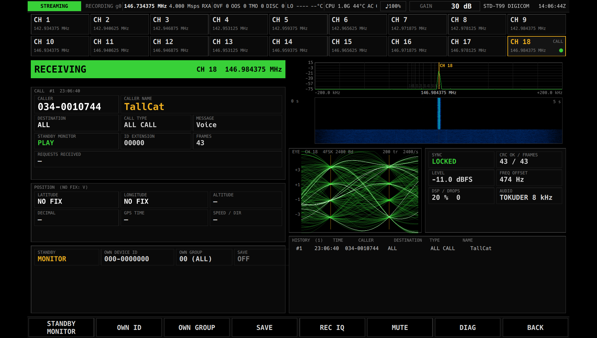

# STD-T99 DIGICOM 説明書

STD-T99 DIGICOM は、デジタル小電力コミュニティ無線(ARIB STD-T99 Annex 2、通称デジコミ)の **1 チャネルを受信して、誰が誰に送っているか・位置・緊急通信を表示し、音声を聞く** ためのアプリです。
音声(TOKUDER)は学習済みのニューラルデコーダーで再生します。

画面全体の操作(メニュー、ステータスバー、GAIN / RX PORT、DIAG ページ、BACK、EXIT、数値入力のしかた)は [共通の操作](README.md) を見てください。

> 注意: 受信した通信の内容を他人に漏らしたり、悪用したりしないでください(電波法第 59 条)。

## できること

- CH1–18(142.934375–142.984375 MHz と 146.934375–146.984375 MHz)から 1 チャネルを選んで受信します。最初は呼出チャネルの CH18 です。
- 送信ごとに、発信者の機器 ID、発信者名、宛先(個別の機器 ID / グループ番号 / 一斉)、通話の種別、緊急通信を表示します。
- 位置通知があれば緯度・経度・高度・GPS 時刻・速度・方位を表示します(送信機が未測位なら `NO FIX`)。
- 選択呼出の待受: 自局の機器 ID とグループ番号を決めておくと、自局宛てでない通話を再生しません(表示と保存はすべての通話)。
- 復号結果(音声の WAV、フレームの記録)と、受信した IQ(SigMF)を保存できます。

受信だけのアプリです。送信・応答はしません。同時に受信できるのは 1 チャネルだけです。

## 用意するもの

- 本体(タブレット)と USRP B210。
- **144 MHz 帯に合ったアンテナ**。B210 の受信端子(`RX PORT` で選んだ端子)につなぎます。
- 音声を聞くためのスピーカーまたはイヤホン。音量は OS 側で調整します。

## 起動と終了

1. メニューの一覧から `STD-T99 DIGICOM` をタップします。
2. 受信が始まると、ステータスバーが `STREAMING` になります。
3. 終わるときは右下の `BACK` を押します。

ステータスバーの周波数は、選んだチャネルより 250 kHz 低い値になります(受信機の都合でわざとずらしています)。

## 画面の見かた

- **上段: チャネル格子** — タップで選局します。上の列が CH1–9、下の列が CH10–18。選んだチャネルは琥珀色の枠で、受信中は右下に緑(緊急なら赤)の丸が付きます。
- **左: 状態の帯** — `SEARCHING`(信号なし)/ `SYNC`(同期中)/ `RECEIVING`(送信を受信中、緑)/ `EMERGENCY 1` `EMERGENCY 2`(赤)/ `EMERGENCY RESPONSE`(琥珀)。
- **左: CALL** — 発信者、発信者名、宛先、通話の種別、メッセージ、待受の判定(`PLAY` 再生する / `NOT FOR US` 自局宛てでない / `PENDING` まだ決まらない)、受けた要求(位置要求など)。
- **左: POSITION** — 位置と GPS 時刻。
- **右上: スペクトラム** — 選んだチャネルを中心に ±200 kHz。同じ群のほかのチャネルに目印。
- **右: EYE** — 復調した信号のアイパターン。4 本の水平線(±1 / ±3)の上で線が交わっていれば良好です。
- **右: 品質** — 同期、CRC が通ったフレーム数、信号レベル、周波数のずれ、DSP 負荷と取りこぼし。
- **右下: HISTORY** — 送信ごとの履歴(新しい順、100 件)。緊急は赤。

## ソフトキー

| キー | 動作 |
|---|---|
| `STANDBY` | 待受を切り替える: `MONITOR`(すべて再生)→ `INDIVIDUAL`(自局宛ての個別通話だけ)→ `GROUP`(自局グループ・一斉・自局宛て個別) |
| `OWN ID` | 自局の機器 ID を入れる(メーカー識別 0–127 → 個別 ID 0–2097151 の 2 回) |
| `OWN GROUP` | 自局のグループ番号(0–63。0 はすべてのグループ) |
| `SAVE` | 復号結果の保存の開始 / 停止。`recordings/std_t99/T99-日時-CHnn` に `.wav`(音声)/ `.burst` / `.llr` / `.jsonl`(全フレーム) |
| `REC IQ` | 受信した IQ をそのまま SigMF で保存(調査・回帰テスト用。4 Msps で 1 分あたり約 1 GB) |
| `MUTE` | 音声を止める |
| `DIAG` | 装置の診断ページ |

待受・自局 ID・グループ・選んだチャネル・MUTE は次に起動したときも残ります。

## 現場ごとの設定(`~/spear/site.conf`)

- `std_t99.channel=<1-18>` — 起動時のチャネル
- `std_t99.lo_offset_hz=<Hz>` — LO をチャネルから離す量(既定 250000)
- 装置の LO 誤差は共通の `radio.freq_err_ppm` で補正されます。
